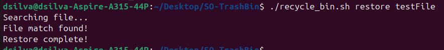
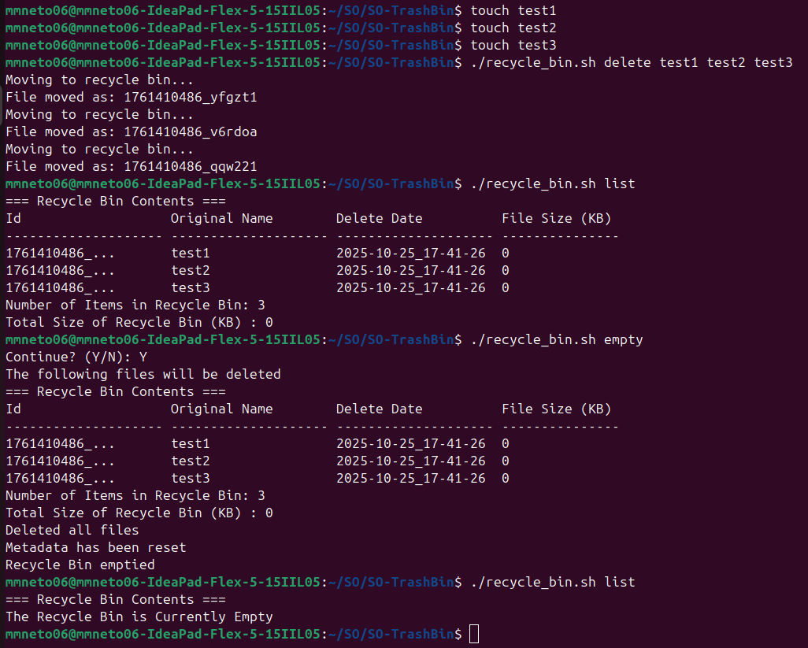
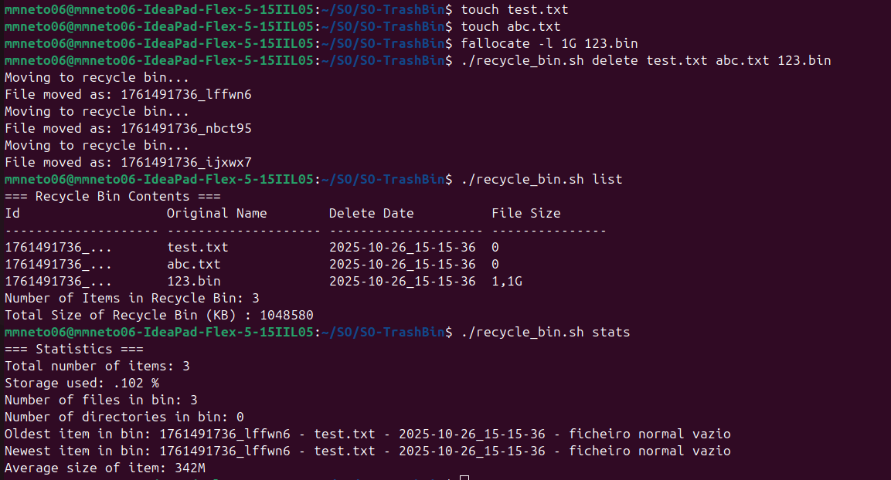
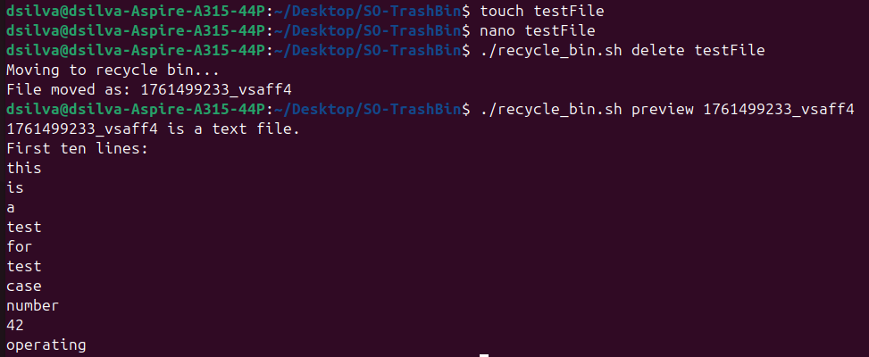
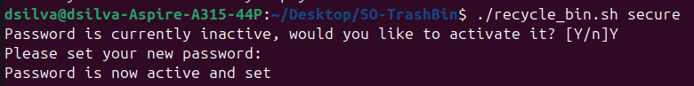

# Linux Recycle Bin System

## Authors
Miguel dos Santos Neto (125200) & Diogo Coelho e Silva (125240) 

## Description

This project consists on the development of a custom recycling bin for Linux systems, implemented in Bash, for the Sistemas Operativos unit course.

This system allows the safe deletion of files, moving them to a recycling area with a metadata file which contains all relevant information about the recycled files. Aditionally, it includes a configuration file, which can be adjusted by the user, as well as a log file wich documents all operations performed.

The user has access to a plethora of features, which will be described with detail through out this document. 

## Installation

To install and configure the system correctly, it is necessary to follow the steps described below:

    1. Download all files from the project and place the in the directory of your choice;

    2. Open your terminal and make sure that your current/working directory is the same as the directory chosen in the step above;

    3. To confirm that the main script is executable, give it execution permissions with the following command:
        chmod +x recycle_bin.sh

    4. The first command to be executed by the script should be *./recycle_bin.sh config*, to configure the recycle bin to your liking. It should be noted that it is not mandatory that this the first command you execute, however some of the functions will result in error in case you don't do it. Aditionally, this first command will create the recycling directory, so that you may start using it.

## Usage
After installing, the system can be run with the main script:
	./recycle_bin.sh [OPTION] [ARGUMENTS]
	
These are the available options: 
- delete \<file\>: Moves the file to the recycle bin, instead of permanently deleting it. It should be noted that it is possible to pass multiple files as the argument, and directories will be accepted instead of files
- list [--detailed]: Lists all files currently in the recycle bin. The --detailed flag shows more information on the listing
- restore <file_name or file_id>: Restores the file/directory to it's original location.
- search <search_pattern>: Searchs for recycled items that match the given pattern.
- empty: [--force] [file_name or file_id]: Permanently eliminates all recycled files after confirmation. The --force flag will skip confirmation. Optionally it is possible to delete a specific file/directory.
- help: Displays a help message with all available commands.
- autoclean: Automatically permanently eliminates the oldest items in the bin. The 'oldness' of a file is specifies in the configuration file.
- stats: Shows statistics about the recycle bin
- config: Opens the configuration file so that it may be edited.
- quota: Checks the disk usage of the bin and compares it to the maximum allowed. If it exceeds the maximum, the user can perform a cleanup.
- preview <file_id>: Shows the first ten lines of content of the corresponding file to the provided id, if the given file is a text file. If it's a binary file, it shows some information about it.
- secure: Allows the enabling and setting of a password as confirmation for more sensitive commands, like empty and autoclean.
	
Use examples:
- ./recycle_bin.sh delete testFile: Sends the file testFile to the recycle bin
- ./recycle_bin.sh delete testFile1 testFile2 testFile3: Sends the files testFile1, testFile2 and testFile3 to the recycle bin. 
- ./recycle_bin.sh list: Lists the content of the bin.
- ./recycle_bin.sh list --detailed: Lists the content of the bin with more detail.
- ./recycle_bin.sh restore testFile: Restores the file testFile, which had been previously recycled. 
- ./recycle_bin.sh restore file_id: Restores the file whose id matches file_id. It should be noted that for all examples that include it, file_id is merely to show the example; when executing the program a real id should be used.
- ./recycle_bin.sh search *.txt: Lists information about all the files with the .txt extension
- ./recycle_bin.sh empty: Empties the recycle bin after user confirmation.
- ./recycle_bin.sh empty --force: Empties the recycle bin.
- ./recycle_bin.sh empty file_id: Eliminates from the recycle bin the file with the specified id after user confirmation
- ./recycle_bin.sh help: Prints help information about how to use the script.
- ./recycle_bin.sh autoclean: Automatically eliminates old files from the recycle bin.
- ./recycle_bin.sh stats: Shows statistics about the recycle bin.
- ./recycle_bin.sh config: Opens the configuration file so that it may be edited.
- ./recycle_bin.sh quota: Checks if the recycle bin has exceeded the defined storage quota, with the option to autoclean if so.
- ./recycle_bin.sh preview file_id: Shows the firts 10 lines of the specified file or inforation about it. 
- ./recycle_bin.sh secure: Checks the password status and asks the user if they want to change it.
	
## Features
### Mandatory features
The following mandatory features were implemented:
- initialize_recyclebin();
- delete_file();
- list_recycled();
- restore_file();
- search_recycled();
- empty_recyclebin();
- display_help();

### Optional features
The following optional features were implemented:
- show_statistics();
- auto_cleanup();
- check_quota();
- preview_file();
- secure_operation();
	
## Configuration

To configure your recycle bin, you should always use the following command: ./recycle_bin.sh config

## Examples
**Screenshots:** 
- Delete operation:

- List operation:

- Restore operation:

- Search operation:

- Empty operation:

- Help:

- Auto Clean Up Operation: 

- Check Quota Operation: 

- Show Statistics Operation:

- File Preview Operation:

- Secure Operation:

## Known Issues

We are unaware of any limitation or bug with our system.

## References

To accomplish this project, several searches and queries were made on several sources, with the goal to aquire the necessary knowledge about commands and techniques fundammental to it's development.
The consulted sources are listed below, duly asscoiated to the development stages in which they were applied (that is, to the implemented features)

delete_file(): 
- silence mv: https://unix.stackexchange.com/questions/87605/is-there-a-way-to-make-mv-fail-silently

list_recycled():
- read line by line: https://stackoverflow.com/questions/10929453/read-a-file-line-by-line-assigning-the-value-to-a-variable
- readable file size (used in stats and searach too): https://stackoverflow.com/questions/15854332/file-size-in-human-readable-format

restore_file():
- silence mv: https://unix.stackexchange.com/questions/87605/is-there-a-way-to-make-mv-fail-silently
- remove lines: https://stackoverflow.com/questions/5410757/how-to-delete-from-a-text-file-all-lines-that-contain-a-specific-string

search_recycled():
- grep to search patterns: https://www.w3schools.com/bash/bash_grep.php
- using cut to separate line: https://unix.stackexchange.com/questions/452508/how-to-use-the-command-cut-to-cut-out-fields-in-a-csv-file-when-fields-contain

empty_recyclebin():
 - confirmation: https://stackoverflow.com/questions/18544359/how-do-i-read-user-input-into-a-variable-in-bash
 - hot to use sed: https://stackoverflow.com/questions/4881930/remove-the-last-line-from-a-file-in-bash & https://askubuntu.com/questions/992213/how-to-delete-specific-lines-from-a-txt-file

show_statistics():

auto_cleanup():
- config file source idea: https://askubuntu.com/questions/743493/best-way-to-read-a-config-file-in-bash
- date epoch: https://schuchert.github.io/daily%20tech/2021/02/14/SedBreakdown.html?utm 

check_quota(): none

file_preview(): none 

secure_operation():
- read -s: https://www.geeksforgeeks.org/linux-unix/bash-script-read-user-input/
- regex explantion: https://stackoverflow.com/questions/48594826/bash-conditional-loop-issue-y-or-y-yes-n-or-n-no

### Usage of LLMs and other notes
It's important to note that LLMs were used as a support tool to comprehend concepts, to study functionalities of commands identified during research and any debugging that ocurred during the development.

Part of the presented code was also developed based on the available support materials.