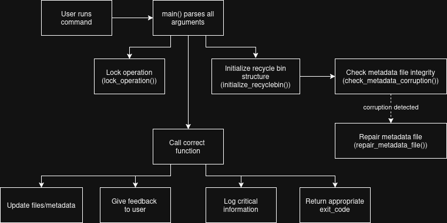
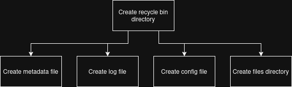
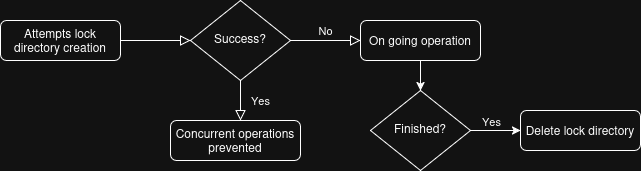
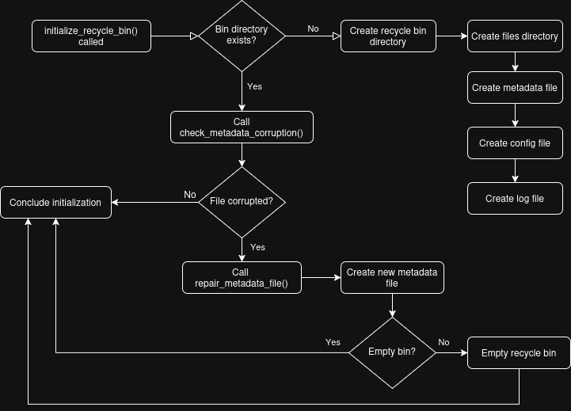
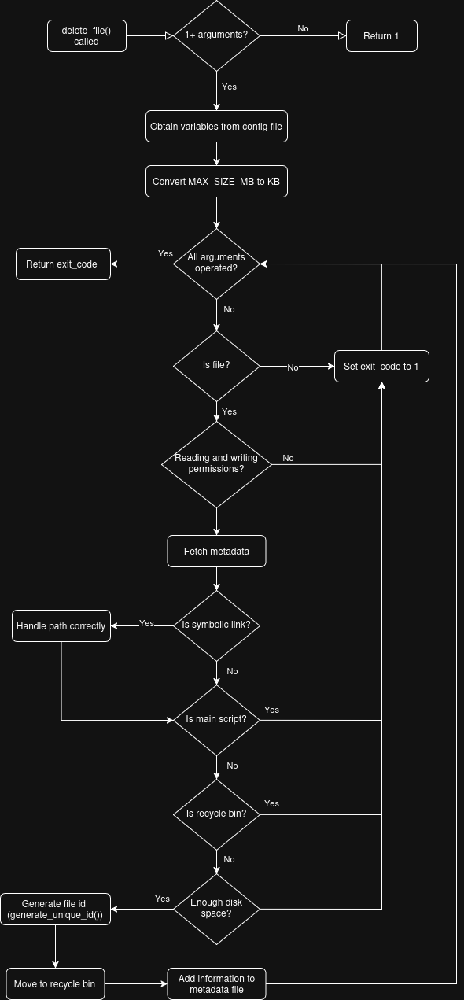

# TECHNICAL DOCUMENT
## Authors
Miguel dos Santos Neto (125200) & Diogo Coelho e Silva (125240) 

## System Architecture Diagram

## Data Flow Diagrams (TODO)
### `initialize_recycle_bin()`

### `delete_file()`

### `list_recycled()` -> MIGUEL

### `restore_file()`

### `search_recycled()`

### `empty_recyclebin()` -> MIGUEL

### `show_statistics()` -> MIGUEL

### `auto_cleanup()` -> MIGUEL

### `check_quota()`

### `preview_file()`

## Metadata Schema Explanation 
### Purpose of Metadata
The metadata file is essential for the correct functioning of the program, as nearly every operation involves reading from or writing to it. It ensures that information about deleted files — such as their original location, size, permissions, and ownership—is preserved, allowing reliable restoration and system management.

### File Structure
The metadata schema follows a CSV-like format, where each line represents a deleted file and contains fields separated by a pipe delimiter (|).

General format: 
ID|ORIGINAL_NAME|ORIGINAL_PATH|DELETION_DATE|FILE_SIZE|FILE_TYPE|PERMISSIONS|OWNER

Parameters: 
- ID: Unique identifier of the deleted file.
- ORIGINAL_NAME: Name of the file before deletion.
- ORIGINAL_PATH: Absolute path where the file was located before deletion.
- DELETION_DATE: Date and time when the file was deleted (YYYY-MM-DD_HH-MM-SS)
- FILE_SIZE: Size of the file at the time of deletion (in KB).
- FILE_TYPE
- PERMISSIONS: File permissions prior to deletion.
- OWNER: User who owned the file.

## Function descriptions 
### `log()`
**Purpose:**  
Writes important information to log file and/or terminal.

**Parameters:**
- $1: message type (info, error)
- $2: where to write (terminal, file or both)			  
- $3: information to write

**Return Value:**  
- `0` on success
- `1` on failure

**Notes:**  
- If message type is error, preserves colors by using `echo -e`.

### `lock_operation()`
**Purpose:**  
Locks current operation, so there can not be any concurrent operations.

**Parameters:** None

**Return Value:**  
- `1` if another instance is running

**Notes:**  
- Uses a temporary directory to check if there are any running operations.
- Logs the operation details to log file and/or user.

### `initialize_recyclebin()`
**Purpose:**  
Initializes the recycle bin structure, including critical directories and files.

**Parameters:** None  

**Return Value:**  
- `0` on success

**Notes:**  
- If the structure is already created, calls `check_metadata_corruption()` function to ensure metadata file is not corrupted.

### `check_metadata_corruption()`
**Purpose:**  
Checks if metadata file is corrupted.

**Parameters:** None  

**Return Value:**  
- `0` on success

**Notes:**  
- If metadata file is corrupted, calls `repair_metadata_file()` function to repair it.
- Logs the operation details to log file and/or user.

### `repair_metadata_file()`
**Purpose:**  
Repairs corrupted metadata file.

**Parameters:** None  

**Return Value:**  
- `0` on success

**Notes:**  
- If recycle bin is not empty, empties it out.
- Logs the operation details to log file and/or user.

### `generate_unique_id()`
**Purpose:**  
Generates unique ID for deleted files

**Parameters:** None  

**Return:**  
- Prints unique ID to stdout

### `delete_file()`
**Purpose:**  
Moves a file or directory to the recycle bin, updates the metadata, and logs the operation.

**Parameters:**
- $1: path to file/directory  

**Return Value:**  
- `0` on success
- `1` on failure

**Notes:**  
- Updates metadata file.
- Checks available disk space before moving the file/directory.
- Handles directories recursively.
- Logs the operation details to log file and/or user.

### `list_recycled()` -> MIGUEL

### `restore_file()`
**Purpose:**  
Restores file from recycle bin, updates the metadata, and logs the operation.

**Parameters:**
- $1: unique ID or name of file to restore

**Return Value:**  
- `0` on success
- `1` on failure

**Notes:**  
- Updates metadata file.
- Checks available disk space before moving the file/directory.
- Preserves file permissions.
- If the original path was deleted, creates parent directories.
- If there is another file with the same name as the restoring file, gives user the option to: 
    - Overwrite file; 
    - Restore with a modified name (with timestamp);
    - Cancel operation.
- Logs the operation details to log file and/or user.

### `empty_recyclebin()` -> MIGUEL

### `search_recycled()`
**Purpose:**  
Search for files in recycle bin.

**Parameters:**
- $1: search pattern

**Return Value:**  
- `0` on success
- `1` on failure

**Notes:**  
- Supports wildcards, by transforming pattern in regex (using sed). Ex: "*.pdf"
- Truncates names and paths, if they are too long.

### `auto_cleanup()` -> MIGUEL

### `check_quota()`
**Purpose:**  
Check if recycle bin exceeds MAX_SIZE_MB.

**Parameters:** None

**Return Value:**  
- `0` on success
- `1` on failure

**Notes:**  
- Gets MAX_SIZE_MB variable from config file.
- If recycle bin is full, ask user permission to clear space.
- If user agrees, calls `auto_cleanup()` to clear space.

### `show_statistics()` -> MIGUEL

### `file_preview()`
**Purpose:**  
Show first 10 lines for text files or file information for binary files.

**Parameters:** 
- $1: unique ID of file to preview

**Return Value:**  
- `0` on success
- `1` on failure

**Notes:**  
- Verifies if file exists on recycle bin.

### `secure_operation()` -> MIGUEL

### `display_help()`
**Purpose:**  
Show usage information.

**Parameters:** None

**Return Value:** `0` 

### `main()`
**Purpose:**  
Main program logic.

**Parameters:** Command line arguments passed by the user.

**Return Value:** Exit code.

**Notes:**  
- Calls `lock_operation()` to prevent concurrent operations.
- Calls `initialize_recyclebin()` to ensure recycle bin structure is correct.
- Parses command line arguments. 
- Invokes the appropriate function based on user's selected operation.

## Design Decisions and Rationale (TODO)
### 1. Language and Environment
**- Context:** The project specification required the implementation to be written in Bash. 

**- Rationale:** This constraint shaped the architecture around shell scripting tools and Unix utilities, ensuring portability and compatibility with Linux environments.

### 2. Recycle Bin Structure
**- Context:** 
The project required the development of a functional recycle bin structure to manage deleted files.

**- Rationale:** 
The following files are critical to the correct behavior of the program: 
- metadata.db: stores critical file information;
- config: contains the recycle bin configuration parameters; 
- recyclebin.log: holds function execution details.

Addicionally, a `files/` directory was used in order to store deleted files.

### 3. Locking Mechanism
**- Context:** 
The goal was to prevent concurrent operations from running simultaneously.

**- Rationale:**
The project guidelines suggested implementing file-based locking to handle concurrent operations. However, during testing, it was observed that multiple processes could create the lock file at the same time, causing race conditions and allowing concurrent executions.

After further research, it was concluded that using a directory-based lock was a more reliable approach, since the mkdir operation is atomic in Unix systems. This guarantees that only one process can successfully create the lock directory, effectively preventing simultaneous operations.

### 4. User Interaction
**- Context:**
As the main goal of the project is the user's program utilization, we needed to ensure there was a way for the user to do it.

**- Rationale:**
The best case scenario was developing a GUI (Graphic User Interface), however due to lack of time and knowledge, we were not able to. 

In this regard, the user can interact with the program by using the terminal to run commands, which may not be easy for unexperienced users.

Concerning this issue, a help function was developed in order to guide the user on program's utilization. 

### 5. Error Handling and Return Codes
**- Context:**
Each function must return an appropriate exit code to indicate the result of its execution.

**- Rationale:**
Following Unix conventions we decided return codes should be:
- `0` on success; 
- `1` on failure. 

All functions are designed to perform the necessary validations to ensure correct behavior and to return the corresponding exit code. This approach facilitates debugging, allows better integration with shell scripts, and ensures consistent error handling across the entire program.

### 6. Log Mechanism
**- Context:**
The program must maintain a record of operations performed, such as file deletions, restorations, and errors, for debugging and auditing purposes, aswell as keeping the user updated.

**- Rationale:**
A dedicated log file (`recyclebin.log`) was implemented to store execution details of each function.

Logging allows developers and users to track the program’s behavior and identify issues.

It is also important to provide users with meaningful feedback about the operations being executed. However, minor internal function operations are not relevant to the user experience, meaning they should not be displayed.

### 7. Metadata Health Check
**- Context:**
The integrity of the metadata file (`metadata.db`) is crucial, since it is an essencial piece to the correct behavior of the program.

**- Rationale:**
A dedicated health check function (`check_metadata_corruption()`) was implemented to ensure the metadata file integrity before performing any operation.

This function should verify if the file was not deleted and if it is readable.
In case any of the verifications fail, the file should be repaired (using `repair_metadata_file()` function).

### 8. Sensitive Operations -> MIGUEL, tu vais saber explicar melhor que eu

## Algorithm Explanations (TODO)
### `lock_operation()`
1. Attemps to create a temporary lock directory (using mkdir, atomic operation).
2. If creation fails, that means there is an operation on going, so exits with exit code 1.
3. Else, when running operation is over, deletes the directory (using trap).

### `initialize_recyclebin()`
1. Verifies if recycle bin directory exists.
    - If not, creates metadata, log and config files, aswell as `files/` directory.
    - Else, calls `check_metadata_corruption()` to ensure metadata file integrity.
2. Concludes initialization by returning 0.

### `check_metadata_corruption()`
1. Checks if the file exists or is readable.
    - Failed verification, calls `repair_metadata_file()`. 
    - Else, returns 0.

### `repair_metadata_file()`
1. Creates new metadata file.
2. Verifies if recycle bin is empty. 
    - If not, empties it by calling `empty_recyclebin() --force` (files data is gone).
    - Else, returns 0.

### `delete_file()`
**Note:** Exit code is set to 0, by default. If any of the verifications fail, exit code is set to 1.

1. Assures there is at least one argument.
2. Obtains variables from config file.
3. Converts MAX_SIZE_MB to KB, for future comparison.

**For every argument passed:** 

4. Validates input is a file.
5. Checks if file exists.
6. Checks file reading and writing permissions.
7. Fetches metadata (not from metadata file).
8. Checks if file is a symbolic link.
    - If it is, the program does not follow it.
9. Checks if user is trying to delete the main script.
10. Checks if user is trying to delete recycle bin itself.
11. Verifies there is enough disk space (through MAX_SIZE_MB transformed variable).
12. Generates file unique Id, by calling `generate_unique_id()` function.
13. Moves file do recycle bin files directory.
14. Adds information to metadata file.

**After for cycle is finished:** 

15. Returns appropriate exit code.

### `list_recycled()` -> MIGUEL

### `restore_file()`

### `empty_recyclebin()` -> MIGUEL

### `search_recycled()`

### `auto_cleanup()` -> MIGUEL

### `check_quota()`

### `show_statistics()` -> MIGUEL

### `file_preview()`

### `secure_operation()` -> MIGUEL

## Flowcharts for Complex Operations (TODO)
### `lock_operation()`

### `initialize_recyclebin()`, `check_metadata_corruption()` and `repair_metadata_file()`

### `delete_file()`
