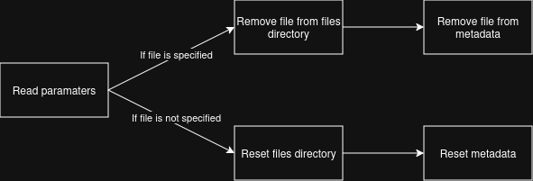
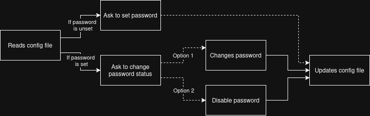
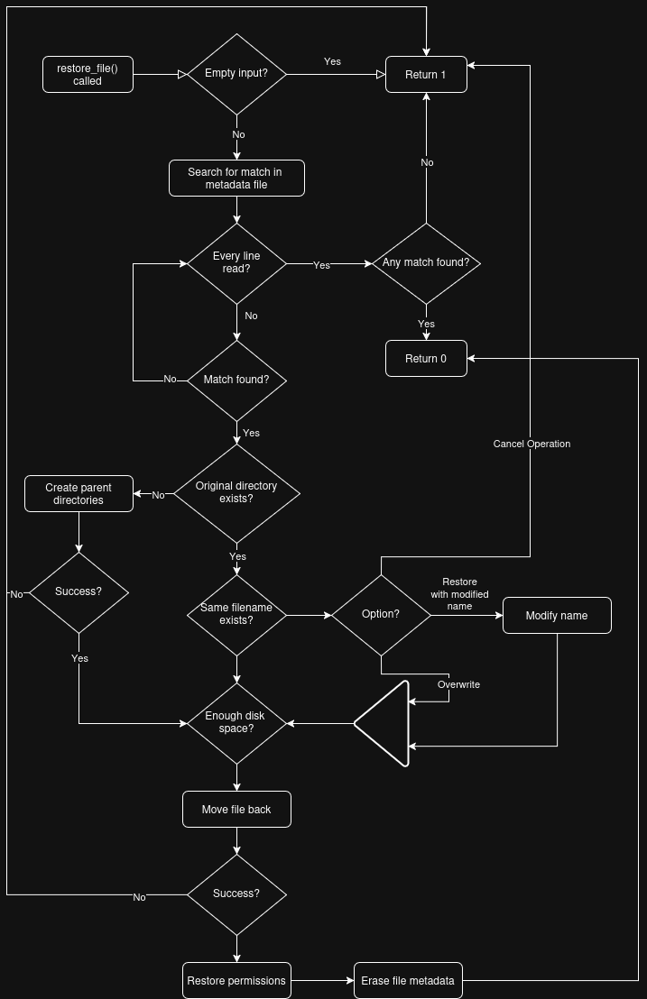
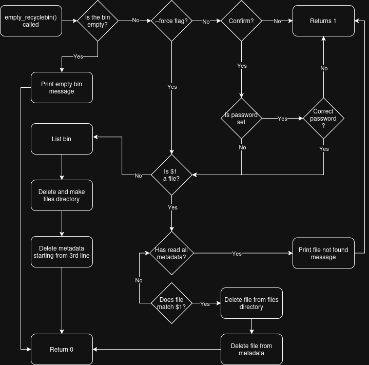
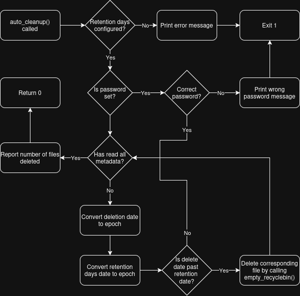
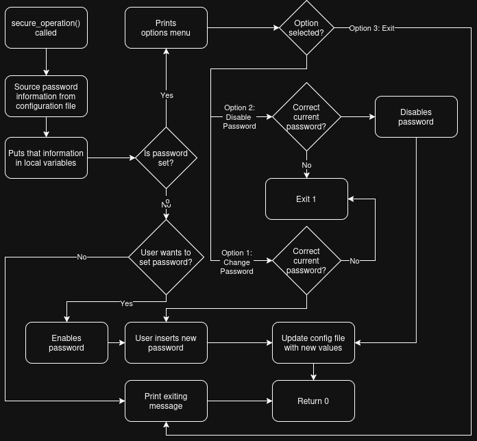

# TECHNICAL DOCUMENT
## Authors
Miguel dos Santos Neto (125200) & Diogo Coelho e Silva (125240) 

## System Architecture Diagram

## Data Flow Diagrams
### `initialize_recycle_bin()`

### `delete_file()`

### `list_recycled()`

### `restore_file()`

### `search_recycled()`

### `empty_recyclebin()`

### `show_statistics()`

### `auto_cleanup()`

### `check_quota()`

### `preview_file()`

### `secure_operation()`

## Metadata Schema Explanation 
### Purpose of Metadata
The metadata file is essential for the correct functioning of the program, as nearly every operation involves reading from or writing to it. It ensures that information about deleted files — such as their original location, size, permissions, and ownership—is preserved, allowing reliable restoration and system management.

### File Structure
The metadata schema follows a CSV-like format, where each line represents a deleted file and contains fields separated by a pipe delimiter (|).

General format: 
ID|ORIGINAL_NAME|ORIGINAL_PATH|DELETION_DATE|FILE_SIZE|FILE_TYPE|PERMISSIONS|OWNER

Parameters: 
- ID: Unique identifier of the deleted file.
- ORIGINAL_NAME: Name of the file before deletion.
- ORIGINAL_PATH: Absolute path where the file was located before deletion.
- DELETION_DATE: Date and time when the file was deleted (YYYY-MM-DD_HH-MM-SS)
- FILE_SIZE: Size of the file at the time of deletion (in KB).
- FILE_TYPE
- PERMISSIONS: File permissions prior to deletion.
- OWNER: User who owned the file.

## Function descriptions 
### `log()`
**Purpose:**  
Writes important information to log file and/or terminal.

**Parameters:**
- $1: message type (info, error)
- $2: where to write (terminal, file or both)			  
- $3: information to write

**Return Value:**  
- `0` on success
- `1` on failure

**Notes:**  
- If message type is error, preserves colors by using `echo -e`.

### `lock_operation()`
**Purpose:**  
Locks current operation, so there can not be any concurrent operations.

**Parameters:** None

**Return Value:**  
- `1` if another instance is running

**Notes:**  
- Uses a temporary directory to check if there are any running operations.
- Logs the operation details to log file and/or user.

### `initialize_recyclebin()`
**Purpose:**  
Initializes the recycle bin structure, including critical directories and files.

**Parameters:** None  

**Return Value:**  
- `0` on success

**Notes:**  
- If the structure is already created, calls `check_metadata_corruption()` function to ensure metadata file is not corrupted.

### `check_metadata_corruption()`
**Purpose:**  
Checks if metadata file is corrupted.

**Parameters:** None  

**Return Value:**  
- `0` on success

**Notes:**  
- If metadata file is corrupted, calls `repair_metadata_file()` function to repair it.
- Logs the operation details to log file and/or user.

### `repair_metadata_file()`
**Purpose:**  
Repairs corrupted metadata file.

**Parameters:** None  

**Return Value:**  
- `0` on success

**Notes:**  
- If recycle bin is not empty, empties it out.
- Logs the operation details to log file and/or user.

### `generate_unique_id()`
**Purpose:**  
Generates unique ID for deleted files

**Parameters:** None  

**Return:**  
- Prints unique ID to stdout

### `delete_file()`
**Purpose:**  
Moves a file or directory to the recycle bin, updates the metadata, and logs the operation.

**Parameters:**
- $1: path to file/directory  

**Return Value:**  
- `0` on success
- `1` on failure

**Notes:**  
- Updates metadata file.
- Checks available disk space before moving the file/directory.
- Handles directories recursively.
- Logs the operation details to log file and/or user.

### `list_recycled()`
**Purpose:**  
List all items currently in the recycle bin, informing at the end the number of items and the total size of the bin.

**Parameters:**
- [OPTIONAL] --detailed: Displays all information in metadata for each file during listing.

**Return Value:**  
- `0` on success

**Notes:**  
- Reads metadata file.
- By default, it only displays the following information about each file:
    - File Id (Truncated) 
    - Original Name
    - Delete Date
    - File Size
- If more information is wanted, use the --detailed flag, as mentioned
- This function has a seperate message if the recycle bin is empty

### `restore_file()`
**Purpose:**  
Restores file from recycle bin, updates the metadata, and logs the operation.

**Parameters:**
- $1: unique ID or name of file to restore

**Return Value:**  
- `0` on success
- `1` on failure

**Notes:**  
- Updates metadata file.
- Checks available disk space before moving the file/directory.
- Preserves file permissions.
- If the original path was deleted, creates parent directories.
- If there is another file with the same name as the restoring file, gives user the option to: 
    - Overwrite file; 
    - Restore with a modified name (with timestamp);
    - Cancel operation.
- Logs the operation details to log file and/or user.

### `empty_recyclebin()`
**Purpose:**  
Empties the recycle bin, deleting all files in it permanently and resets the metadata.

**Parameters:**
- [OPTIONAL] $1: unique id or name to permanently delete
- [OPTIONAL] --force: Forces the bin to empty, without requiring user confirmation before hand

**Return Value:**  
- `0` on success
- `1` on failure

**Notes:**  
- Resets metadata, as well as the files directory.
- Has special messsage in case the recycle bin is empty
- Uses the password set with secure_operation() if it's enabled
- Can delete a specific item with the $1 parameter; the parameter is fully optional, without it the whole bin is emptied
- The --force flag can be used with the $1 paramater, with that paramater coming in first
    - However, the combination is primarily used by the auto_cleanup function

### `search_recycled()`
**Purpose:**  
Search for files in recycle bin.

**Parameters:**
- $1: search pattern

**Return Value:**  
- `0` on success
- `1` on failure

**Notes:**  
- Supports wildcards, by transforming pattern in regex (using sed). Ex: "*.pdf"
- Truncates names and paths, if they are too long.

### `auto_cleanup()`
**Purpose:**  
Automatically cleans the recycle bin by looking for old files and permanently deleting them.

**Parameters:** None

**Return Value:**  
- `0` on success
- `1` on failure

**Notes:**  
- Updates metadata
- The maximum retention for the files is configures in the configuration file
- Uses the empty_recyclebin() function with $1 and --force
- Uses the password set with secure_operation() if it's enabled
- In the end it shows how many files were automatically cleaned

### `check_quota()`
**Purpose:**  
Check if recycle bin exceeds MAX_SIZE_MB.

**Parameters:** None

**Return Value:**  
- `0` on success
- `1` on failure

**Notes:**  
- Gets MAX_SIZE_MB variable from config file.
- If recycle bin is full, ask user permission to clear space.
- If user agrees, calls `auto_cleanup()` to clear space.

### `show_statistics()`
**Purpose:**  
Displays a variety of statistics related to the recycle bin

**Parameters:** None

**Return Value:**  
- `0` on success

**Notes:**  
- Reads metadata

### `file_preview()`
**Purpose:**  
Show first 10 lines for text files or file information for binary files.

**Parameters:** 
- $1: unique ID of file to preview

**Return Value:**  
- `0` on success
- `1` on failure

**Notes:**  
- Verifies if file exists on recycle bin.

### `secure_operation()`
**Purpose:**  
Allows the user to set a password for sensitive operations

**Parameters:** None

**Return Value:**
- `0` on success
- `1` on failure

**Notes:**  
- Stores the password value and wether it's active in the configuration file
- If password is set, empty_recyclebin() and auto_cleanup() will require extra confirmation

### `main()`
**Purpose:**  
Main program logic.

**Parameters:** Command line arguments passed by the user.

**Return Value:** Exit code.

**Notes:**  
- Calls `lock_operation()` to prevent concurrent operations.
- Calls `initialize_recyclebin()` to ensure recycle bin structure is correct.
- Parses command line arguments. 
- Invokes the appropriate function based on user's selected operation.

### `display_help()`
**Purpose:**  
Show usage information.

**Parameters:** None

**Return Value:** `0` 

### `main()`
**Purpose:**  
Main program logic.

**Parameters:** Command line arguments passed by the user.

**Return Value:** Exit code.

**Notes:**  
- Calls `lock_operation()` to prevent concurrent operations.
- Calls `initialize_recyclebin()` to ensure recycle bin structure is correct.
- Parses command line arguments. 
- Invokes the appropriate function based on user's selected operation.

## Design Decisions and Rationale
### 1. Language and Environment
**- Context:** The project specification required the implementation to be written in Bash. 

**- Rationale:** This constraint shaped the architecture around shell scripting tools and Unix utilities, ensuring portability and compatibility with Linux environments.

### 2. Recycle Bin Structure
**- Context:** 
The project required the development of a functional recycle bin structure to manage deleted files.

**- Rationale:** 
The following files are critical to the correct behavior of the program: 
- metadata.db: stores critical file information;
- config: contains the recycle bin configuration parameters; 
- recyclebin.log: holds function execution details.

Additionally, a `files/` directory was used in order to store deleted files.

### 3. Locking Mechanism
**- Context:** 
The goal was to prevent concurrent operations from running simultaneously.

**- Rationale:**
The project guidelines suggested implementing file-based locking to handle concurrent operations. However, during testing, it was observed that multiple processes could create the lock file at the same time, causing race conditions and allowing concurrent executions.

After further research, it was concluded that using a directory-based lock was a more reliable approach, since the mkdir operation is atomic in Unix systems. This guarantees that only one process can successfully create the lock directory, effectively preventing simultaneous operations.

### 4. User Interaction
**- Context:**
As the main goal of the project is the user's program utilization, we needed to ensure there was a way for the user to do it.

**- Rationale:**
The best case scenario was developing a GUI (Graphic User Interface), however due to lack of time and knowledge, we were not able to. 

In this regard, the user can interact with the program by using the terminal to run commands, which may not be easy for unexperienced users.

Concerning this issue, a help function was developed in order to guide the user on program's utilization. 

### 5. Error Handling and Return Codes
**- Context:**
Each function must return an appropriate exit code to indicate the result of its execution.

**- Rationale:**
Following Unix conventions we decided return codes should be:
- `0` on success; 
- `1` on failure. 

All functions are designed to perform the necessary validations to ensure correct behavior and to return the corresponding exit code. This approach facilitates debugging, allows better integration with shell scripts, and ensures consistent error handling across the entire program.

### 6. Log Mechanism
**- Context:**
The program must maintain a record of operations performed, such as file deletions, restorations, and errors, for debugging and auditing purposes, aswell as keeping the user updated.

**- Rationale:**
A dedicated log file (`recyclebin.log`) was implemented to store execution details of each function.

Logging allows developers and users to track the program’s behavior and identify issues.

It is also important to provide users with meaningful feedback about the operations being executed. However, minor internal function operations are not relevant to the user experience, meaning they should not be displayed.

### 7. Metadata Health Check
**- Context:**
The integrity of the metadata file (`metadata.db`) is crucial, since it is an essencial piece to the correct behavior of the program.

**- Rationale:**
A dedicated health check function (`check_metadata_corruption()`) was implemented to ensure the metadata file integrity before performing any operation.

This function should verify if the file was not deleted and if it is readable.
In case any of the verifications fail, the file should be repaired (using `repair_metadata_file()` function).

### 8. Sensitive Operations
**- Context:**
The user can, at any point, set a password to protect certain sensiteve operations of the program.

**- Rationale:**
A dedicated function (`secure_operation()`) was implemented for the user to set, change and disable a password for the program.

With a password set, the `empty_recyclebin()` function (without --force flag) and `auto_cleanup()` fucntion will now require the password to continue.

These operation were deamed sensitive since they permanently delete files from the bin.

## Algorithm Explanations
### `lock_operation()`
1. Attemps to create a temporary lock directory (using mkdir, atomic operation).
2. If creation fails, that means there is an operation on going, so exits with exit code 1.
3. Else, when running operation is over, deletes the directory (using trap).

### `initialize_recyclebin()`
1. Verifies if recycle bin directory exists.
    - If not, creates metadata, log and config files, aswell as `files/` directory.
    - Else, calls `check_metadata_corruption()` to ensure metadata file integrity.
2. Concludes initialization by returning 0.

### `check_metadata_corruption()`
1. Checks if the file exists or is readable.
    - Failed verification, calls `repair_metadata_file()`. 
    - Else, returns 0.

### `repair_metadata_file()`
1. Creates new metadata file.
2. Verifies if recycle bin is empty. 
    - If not, empties it by calling `empty_recyclebin() --force` (files data is gone).
    - Else, returns 0.

### `delete_file()`
**Note:** Exit code is set to 0, by default. If any of the verifications fail, exit code is set to 1.

1. Assures there is at least one argument.
2. Obtains variables from config file.
3. Converts MAX_SIZE_MB to KB, for future comparison.

**For every argument passed:** 

4. Validates input is not empty.
5. Checks if file exists.
6. Checks file reading and writing permissions.
7. Fetches metadata (not from metadata file).
8. Checks if file is a symbolic link.
    - If it is, the program does not follow it.
9. Checks if user is trying to delete the main script.
10. Checks if user is trying to delete recycle bin itself.
11. Verifies there is enough disk space (through MAX_SIZE_MB transformed variable).
12. Generates file unique Id, by calling `generate_unique_id()` function.
13. Moves file do recycle bin files directory.
14. Adds information to metadata file.

**After for cycle is finished:** 

15. Returns appropriate exit code.

### `list_recycled()`
1. Prints initial header.
2. Checks if the recycle bin is empty.
    - If so, program prints that information and ends.
3. Initializes variables to count number of items and total size.
4. Checks for --detailed flag.

**For every line in metadata:**

5. Checks for the initial headers, ignoring the initial one.
    - If it's the second header ("ID,ORIGINAL_NAME,..."), then prints the 'table header';
        - This header is different depending on the --detailed flag;
6. Prints every line of metadata in a formatted string.
    - Amount of information displayed per line depends on the --detailed flag;
    - Truncates the original name and/or the original path of they are too long;
    - Converts the file size to a readable format;
7. Updates the variables initialized in step 3.

**After for cycle is finished:** 

8. Displays the number of items in the bin
9. Displays the total size of the bin in a readable format
10. Returns 0 

### `restore_file()`
1. Validates input is not empty.
2. Searches by file_name or file-id, by interating through every metadata file line.

**If a match is found:**

3. Verifies if original directory exists.
    - If not, creates parent directories. Insufficient permissions result on function return with value 1.
4. Verifies if file exists at original directory.
    - If so, the user is presented with the following options:
        - Overwrite file; 
        - Restore with a modified name (adittional timestamp);
        - Cancel operation -> Return 1;
5. Verifies there is enough disk space;
6. Moves file back to its original directory. Insufficient permissions result on function return with value 1.
7. Restores original permissions.
8. Erases file metadata.

**If no match was found:** Function returns with value 1.

### `empty_recyclebin()`
1. Checks if the bin is empty
    -If so, prints messages saying so and returns 0
2. Checks for the --force flag
3. If the --force flag was not on, asks for confirmation before continuing
    - If it gets cancelled, exits with code 1
    - If password is active, then also asks for it
        - If wrong password is introduced, exits with code 1
4. Checks if the first paramenter is a file
    - If so, cycles through the whole metadata looking for the file with the matching id or original name
        - If it finds it, removes it from the files directory and form metadata, and the function returns 0
        - If not found, prints error and returns 1
5. If the file paramater is not given, lists entire bin, logging what will be permanently deleted
6. Removes and remakes the files directory
7. Deletes all lines from metadata, starting from the third line
8. Returns 0

### `search_recycled()`
1. Transforms pattern passed as argument into regex (using sed), escaping special characteres in order to support wildcards.
2. Attemps to find a match on file name or path, by interating through every metadata file line and comparing (using grep).

**If a match is found:**

3. Fecthes important data from metadata file.
4. If file name or path is too long, truncates them.
5. Prints file information.

**If no match was found:** Function returns with value 1.

### `auto_cleanup()`
1. Sources the configuration file and initializes the count variable
2. Checks if retention days is configured
    -If not, prints message and exits with code 1
3. Checks if password is active
    -If so, asks for password confirmation
        -If wrong password is inserted, exits with code 1

**For every line in metadata:**

4. Skips the header lines by checking for them
5. Gets the deletion date of the file and converts it to an epoch (i.e., converts to seconds)
6. Gets the cutoff date as an epoch, using the current date and the RETENTION_DAYS variable in the configuration file
7. Compares both dates
    -If the cutoff epoch is bigger than the deletion date: 
        - The user is informed that the file will be permanently deleted
        - The file is forcibly removed using empty_recyclebin
        - The count variable is updated

**After for cycle is finished:** 

8. Display how many files have been removed with this function
    -If none have been removed, a special message is displayed
9. Returns 0

### `check_quota()`
1. Obtains MAX_SIZE_MB variable from config file.
2. Gets recycle bin size in MB.
3. If recycle bin size is greater or equal to MAX_SIZE_MB, the user is informed that recycle bin is full.
4. Askes user permissions to clear space.
    - User agrees, cleares space by calling `auto_cleanup()` function.
    - Else, returns 1.
5. Returns 0

### `show_statistics()`
1. Source the configuration file and initialize all local variables used to keep track of the statistics. The variables include:
    - Total items
	- Total size
	- Number of files
	- Number of directories
	- Oldest deleted item
	- Oldest time (associated to oldest deleted item)
	- Newest deleted file
	- Newest time (associated to newest deleted item)

**For every line in metadata:**

2. Skips the header lines by checking for them
3. Updates all the variables accordingly

**After for cycle is finished:** 

4. Converts all file sizes to a readable format
5. Logs in both the terminal and the log file all the statistics recorded
    - From the configuration file, the quota is sourced to calculate quota percentage

### `file_preview()`
**Note:** If any of the verifications fail, function returns 1.

1. Validates input is not empty.
2. Checks if file exists on recycle bin.
3. Checks if is a text file.
    - If so, displays the first ten lines of its content.
    - Else (binary file), displays file information.
4. Return 0.

### `secure_operation()`

1. Sources configuration file and saves 2 of it's variables to local ones
2. Checks if password is active

**If password is inactive:**

3. Asks user if they wish to activate it
    - If so, user introduces new password and updates local variables
    - If not, returns 0

**If password is active:**

3. Asks user if they with to do anything to it's status
    - Available options
    1. Disable password
        - User can disable password by introducing current one
            -If wrong password is introduced, exits with code 1
        - Local variables are updated
    2. Change password
        - User can change password after introducing current one
            -If wrong password is introduced, exits with code 1
        - Local variables are updates
    3. Exit
        -Returns 0

4. Configuration file is updated with the local variables' values
5. Returns 0

## Flowcharts for Complex Operations
### `lock_operation()`

### `initialize_recyclebin()`, `check_metadata_corruption()` and `repair_metadata_file()`

### `delete_file()`

### `restore_file()`

### `empty_recyclebin()`

### `auto_cleanup()`

### `secure_operation()`

