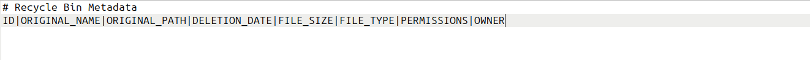

# MANUAL TESTING

## Basic Functionality Tests

### Test Case 1: Initialize Recycle Bin Structure
**Objective:** Verify that the recycle bin structure is initialized correctly.

**Steps:**
1. Run the main script with an option of your choice: `./recycle_bin.sh help`
2. Verify the following message is written on the terminal: `echo "Recycle bin initialized at ~/.recycle_bin"`
3. Run `ls ~/.recycle_bin`
4. Verify `config`, `metadata.db` and `recyclebin.log` files are there, aswell as `files` directory.

**Expected Result:**
- ~/.recycle_bin directory is created
- config, metadata.db and recyclebin.log files are created
- files directory is created
- Success message is displayed

**Actual Result:** 
- Sucess message displayed: "Recycle bin initialized at ~/.recycle_bin"
- Files and directoried are created: config, metadata.db, recyclebin.log, files/

**Status:** ✅ Pass

**Screenshots:** 
- Success message displayed: 

- Recycle bin structure: 

### Test Case 2: Delete Single File
**Objective:** Verify that a single file can be deleted successfully

**Steps:**
1. Create test file: `touch testFile`
2. Run: `./recycle_bin.sh delete testFile`
3. Verify file is removed from current directory
4. Run: `./recycle_bin.sh list`
5. Verify file appears in recycle bin
**Expected Result:**
- File is moved to ~/.recycle_bin/files/
- Metadata entry is created
- Success message is displayed
- File appears in list output
**Actual Result:** 
- Success message is displayed: "File moved as: 1761143792_w5fmrh"
- File is removed from current directory
- Metadata entry is created: "1761143792_w5fmrh|testFile|/home/dsilva/Desktop/SO-TrashBin/testFile|2025-10-22_15-36-32|4|regular file|664|dsilva:dsilva"
- File appears in list output

**Status:** ✅ Pass

**Screenshots:** 
- Success message displayed:

- Metadata entry: 

- List output: 

### Test Case 3: Delete Multiple Files in One Command
**Objective:** Verify that multiple files can be deleted successfully

**Steps:**
1. Create multiple test files: `touch testFile1 testFile2 testFile3`
2. Run: `./recycle_bin.sh delete testFile1 testFile2 testFile3`
3. Verify files are removed from current directory
4. Run: `./recycle_bin.sh list`
5. Verify files appear in recycle bin

**Expected Result:**
- Files are moved to ~/.recycle_bin/files/
- Metadata entries are created
- Success messages are displayed
- Files appear in list output

**Actual Result:** 
- Success messages are displayed: "File moved as: 1761144530_sr1jzu", "File moved as: 1761144530_1e1ph2", "File moved as: 1761144531_fkuhhq".
- Files are removed from current directory
- Metadata entries are created: "1761144530_sr1jzu|testFile1|/home/dsilva/Desktop/SO-TrashBin/testFile1|2025-10-22_15-48-50|0|regular empty file|664|dsilva:dsilva", "1761144530_1e1ph2|testFile2|/home/dsilva/Desktop/SO-TrashBin/testFile2|2025-10-22_15-48-50|0|regular empty file|664|dsilva:dsilva", "1761144531_fkuhhq|testFile3|/home/dsilva/Desktop/SO-TrashBin/testFile3|2025-10-22_15-48-51|0|regular empty file|664|dsilva:dsilva"
- Files appear in list output

**Status:** ✅ Pass

**Screenshots:** 
- Success messages displayed:

- Metadata entries: 

- List output: 

### Test Case 4: TODO (Delete Empty Directory) -> EU 

### Test Case 5: TODO (Delete Directory with Contents (recursive)) -> EU

### Test Case 6: TODO (List Empty Recycle Bin)

### Test Case 7: Restore Single File
**Objective:** Verify that a single file can be restored successfully

**Pre-condition:** File must already exist in recycle bin (follow Test Case 2: Delete Single File).

**Steps:**
1. Run: `./recycle_bin.sh restore testFile` or `./recycle_bin.sh restore [file_id]`
2. Verify file is back at original directory
3. Run: `./recycle_bin.sh list`
4. Verify restored file does not appear in recycle bin

**Expected Result:**
- File is moved to original directory
- Metadata entry is erased
- Success message is displayed
- File does not appear in list output

**Actual Result:** 
- Success message is displayed: "Restore complete!"
- File is moved to original directory
- Metadata entry is erased
- File does not appear in list output

**Status:** ✅ Pass

**Screenshots:** 
- Success message displayed:

- Metadata file has no entries: 

- List output: 

### Test Case 8: Restore to Non-existent Original Path -> VAI SOFRER ALTERAÇÕES, TODO
**Objective:** Verify that a file can be restored to a non-existent original path successfully

**Important:** Be careful with file names (it is safer to use file ids) or make sure that recycle bin is empty.

**Steps:**
1. Run (Create test directory): `mkdir -p testDir`
2. Run (Create test file inside test directory): `touch testDir/testFile`
3. Run: `./recycle_bin.sh delete testDir/testFile`
4. Verify that testFile is not inside testDir anymore
5. Run: `rmdir testDir`
6. Verify testDir does not exist anymore
7. Run: `./recycle_bin.sh restore testFile`
8. Verify that testDir (original directory) is created and that testFile is inside it.

**Expected Result:**
- File is moved to ~/.recycle_bin/files/
- Success deletion message is displayed
- Original directory is created
- File is moved to original directory
- Metadata entry is erased
- Success restore message is displayed
- File does not appear in list output

**Actual Result:** 
- Success deletion message is displayed: "File moved as: "
- File is moved to original directory
- Metadata entry is erased
- File does not appear in list output

**Status:** ✅ Pass

**Screenshots:** 
- Success message displayed:

- Metadata file has no entries: 

- List output: 

### Test Case 9: TODO (Empty Entire Recycle Bin)

### Test Case 10: Search Existing File
**Objective:** Verify that a search for an existing file can be done successfully

**Pre-condition:** File must already exist in recycle bin (follow Test Case 2: Delete Single File).

**Steps:**
1. Run: `./recycle_bin.sh search testFile`
2. Verify that file information is displayed

**Expected Result:**
- File information is displayed

**Actual Result:** 
- File information is displayed, including file id, original name, original path, deletion date, size, type, permissions and owner.

**Status:** ✅ Pass

**Screenshots:** 
- File informations: 

### Test Case 11: Search Non-Existent File
**Objective:** Verify that a search for a non-existent file can not be performed

**Steps:**
1. Run: `./recycle_bin.sh search nonExistentFile`
2. Verify that an error message is displayed

**Expected Result:**
- Error message is displayed

**Actual Result:** 
- Error message is displayed: "Error: No file with 'nonExistentFile' pattern was found."

**Status:** ✅ Pass

**Screenshots:** 
- Error message: 

### Test Case 12: Display Help Information (Vai faltar print, falta completar a função)
**Objective:** Verify that help information is displayed successfully

**Steps:**
1. Run: `./recycle_bin.sh help` or `./recycle_bin.sh --help` or `./recycle_bin.sh -h`
2. Verify that help message is displayed

**Expected Result:**
- Help message is displayed

**Actual Result:** 
- Help message displays information regarding every executable option of the program

**Status:** ✅ Pass

**Screenshots:** FALTA ISTO
- Help message: 

## Edge Cases (EU)

### Test Case 13: Delete Non-Existent File
**Objective:** Verify that it is not possible to delete a non-existent file

**Steps:**
1. Run: `./recycle_bin.sh delete nonExistentFile`
2. Verify that an error message is displayed

**Expected Result:**
- Error message is displayed

**Actual Result:** 
- Error message is displayed: "Error: File 'nonExistentFile' does not exist"

**Status:** ✅ Pass

**Screenshots:** 
- Error message: 

### Test Case 14: Delete File Without Permissions (TODO) -> EU 
**Objective:** Verify that the script handles attempts to delete a file without sufficient permissions correctly.

**WARNING**: This test case requires superuser permissions (sudo). Use caution, as incorrect execution of privileged commands may affect system stability.

**Steps:**
1. Run (Create a file on a protected directory): `sudo touch /protectedFile`
2. Run: `./recycle_bin.sh delete /protectedFile`
3. Verify that an error message is displayed
4. Verify that the file was not moved from it's current directory
5. Run: `./recycle_bin.sh list`
6. Verify that the file does not appear on the list
7. (Optional) Remove the test file: `sudo rm /protectedFile`

**Expected Result:**
- Error message is displayed
- File is not moved
- File does not appear on recycle bin files list

**Actual Result:** 
- Error message is displayed: "Error: Permission denied!"
- File is not moved
- File does not appear on recycle bin files list

**Status:** ✅ Pass

**Screenshots:** FALTA ISTO AQUI 
- Test image: 

### Test Case 15: Restore when Original Location has same Filename (TODO) -> EU
**Objective:** Verify that the script handles attempts to delete a file without sufficient permissions correctly.

**Pre-condition:** File must already exist in recycle bin (follow Test Case 2: Delete Single File) and there should be a file, with the same name as the deleted one, in the restoring directory.

**Steps:**
1. Run (Create a new file): `touch protectedFile`
2. Run (Change permissions): `chmod 000 protectedFile`
3. Run: `./recycle_bin.sh delete protectedFile`
4. Verify that an error message is displayed
5. Verify that the file was not moved from it's current directory
6. Run: `./recycle_bin.sh list`
7. Verify that the file does not appear on the list

**Expected Result:**
- Error message is displayed
- File is not moved
- File does not appear on recycle bin files list

**Actual Result:** 
- Error message is displayed: "Error: File 'nonExistentFile' does not exist"

**Status:** ✅ Pass

**Screenshots:** 
- Test image: 

### Test Case 16: Restore with Non-Existent File Id (TODO) -> EU 

### Test Case 17: Handle Filenames with Spaces (TODO) -> EU 

### Test Case 18: Handle Filenames with Special Characters (TODO) -> EU 

### Test Case 19: Handle Very Long Filenames (TODO)

### Test Case 20: Handle Very Large Files (TODO) -> EU 

### Test Case 21: Handle Symbolical Links (TODO) -> EU 

### Test Case 22: Handle Hidden Files (TODO) -> EU 

### Test Case 23: Delete Files from Different Directories (TODO) -> EU

### Test Case 24: Restore Files to Read-Only Directories (TODO) -> EU 

## Error Handling (MIGUEL)

### Test Case 25: Invalid Command Line Arguments
**Objective:** Verify that the script handles attempts to execute non existent commands

**Steps:**
1. Run a non existent command: `./recycle_bin.sh nonexistentcommand abc 123`
2. Verify that an error message is displayed

**Expected Result:**
- Error message is displayed
- Nothing within the directory ~/recycle_bin is changed

**Actual Result:** 
- Error message is displayed: "Invalid option. Use 'help' for usage information."
- Nothing in that directpry changes since no other function was called

**Status:** ✅ Pass

**Screenshots:** 
- Error message: 

### Test Case 26: Missing Required Parameters
**Objective:** Check that the script alerts the user of missing and/or required paramaters

**Steps:**
1. Run a command that requires a paramater, like delete: `./recycle_bin.sh delete`
2. Verify that an error message is displayed

**Expected Result:**
- Error message is displayed
- User is informed of correct usage

**Actual Result:** 
- Error message is displayed: "Must indicate at least one file/directory for deletion"
- User is informed of correct use: "Use: ./recycle_bin.sh delete \<file1\> \<file2\> ... \<fileN\>"

**Status:** ✅ Pass

**Screenshots:** 
- Error message: 

### Test Case 27: Corrupted Metadata File
TODO - idk how to do this

### Test Case 28: Insufficient Disk Space
TODO - idk how to do this

### Test Case 29: Permission Denied Errors
**Objective:** Check that the script does not remove files or directories without system permission

**Steps:**
1. Run (make a test directory): `mkdir .test`
1. Run (create a test file): `touch ./.test/test`
2. Run (remove all permissions from the test directory): `chmod 0 ./.test`
3. Run (try to delete the file with the script): `./recycle_bin.sh delete ./.test/test`
3. Run (try to delete the directory with the script): `./recycle_bin.sh delete ./.test`
4. Verify that an error message is displayed either by the system or by the script

**Expected Result:**
- Error message is displayed by either the system or the script itself
- File is not moved to the recycle bin
- Directory is not moved to the recycle bin

**Actual Result:** 
- Error message is displayed by the script for the file: "Error: File './.test/test' does not exist"
- Error message is displayed by the system (and a bit of the script) for the directory: 
<pre>du: impossível ler a pasta &apos;/home/mmneto06/SO/SO-TrashBin/.test&apos;: Permissão recusada
Moving to recycle bin...
mv: impossível mover &apos;/home/mmneto06/SO/SO-TrashBin/.test&apos; para &apos;/home/mmneto06/.recycle_bin/files/1761404641_fwybob&apos;: Permissão recusada
Error: Permission denied!
</pre>
- Recycle bin, test file and test directory remain in their original conditions

**Status:** ✅ Pass

**Screenshots:** 
- Error messages: 

### Test Case 30: Attempting to Delete Recycle Bin Itself
**Objective:** Check that the script stops user from deleting the recycle bin itself

**Steps:**
1. Run the command: `./recycle_bin.sh delete ~/.recycle_bin`
2. Verify that an error message is displayed

**Expected Result:**
- Error message is displayed
- Recycle bin is not deleted and stays the same

**Actual Result:** 
- Error message is displayed: "Error: Cannot delete recycle bin itself."
- ~/.recycle_bin still exists and is unchanged
- Log file logs attempt at deleting recycle_bin

**Status:** ✅ Pass

**Screenshots:** 
- Error message: 

### Test Case 31: Concurrent Operations
TODO - wtf does this mean

## Performance Tests

### Test Case 32: Delete 100+ Files
**Objective:** Check how fast the script can delete 100 files

**Steps:**
1. Create 100 files, all with the touch command
2. Delete each one individually
3. Check how long it took to delete them all

OR

1. Run the auxiliary script testingMdScripts/performance.sh to do the above steps automatically

**Expected Result:**
- All files created are deleted
- Script doesn't take a long time to run

**Actual Result:** 
- Script ran successfully to delete 100 files
- Time elapsed to delete is always slighly different, but averages at 2 seconds
- That means that, on average, it takes 0.02 seconds to delete a file

**Status:** ✅ Pass

**Screenshots:** 
- Testing image: 

...

- After this, the recycle_bin.sh script is run to empty the recycle bin, and the temporary test directory that held the test files is deleted 

### Test Case 33: List Recycle Bin with 100+ Files
**Objective:** Check how fast the script can list 100 files

**Steps:**
1. Create 100 files, all with the touch command
2. Delete each one individually
3. Run script with list command
4. Check how long it took to list them all

OR

1. Run the auxiliary script testingMdScripts/performance.sh to do the above steps automatically

**Expected Result:**
- All files created are listed
- Script doesn't take a long time to run

**Actual Result:** 
- Script runs successfully
- Time elapsed is always different, but averages at 0.008 seconds
- That means that, on average, it takes the list command 0.00008 seconsd per file to fully run
- NOTE: the '--detailed' flag does not change the average time to list

**Status:** ✅ Pass

**Screenshots:** 
- Testing image: 

- After this, the recycle_bin.sh script is run to empty the recycle bin, and the temporary test directory that held the test files is deleted 

### Test Case 34: Search in Large Metadata File
**Objective:** Check how fast the script can restore a file from the bin with 100 items

**Steps:**
1. Create 100 files, all with the touch command
2. Delete each one individually
3. Run script with the command search 1, for example
4. Check how long it took to restore the file

OR

1. Run the auxiliary script testingMdScripts/performance.sh to do the above steps automatically

**Expected Result:**
- The script successfully finds all items with a 1 in it's original name/path
- Script doesn't take a long time to run

**Actual Result:** 
- Script runs successfully
- Time elapsed is always different, depeneds how many items show up. In this case, it took on average 0.3 seconds
- If we use as the search pattern something that every files has, it takes roughly 2 seconds, the same ammount of time it took to delete all the files

**Status:** ✅ Pass

**Screenshots:** 
- Testing image: 

- After this, the recycle_bin.sh script is run to empty the recycle bin, and the temporary test directory that held the test files is deleted 

### Test Case 35: Restore from Recycle Bin with Many Items
**Objective:** Check how fast the script can restore a file from the bin with 100 items

**Steps:**
1. Create 100 files, all with the touch command
2. Delete each one individually
3. Run script with the command restore file_100, to test worst case scenario
4. Check how long it took to restore the file

OR

1. Run the auxiliary script testingMdScripts/performance.sh to do the above steps automatically

**Expected Result:**
- The file is successfully restored
- Script doesn't take a long time to run

**Actual Result:** 
- Script runs successfully
- Time elapsed is always different, but averages at 0.2 seconds

**Status:** ✅ Pass

**Screenshots:** 
- Testing image: 

- After this, the recycle_bin.sh script is run to empty the recycle bin, and the temporary test directory that held the test files is deleted 

## Optional Features Tests (SPLIT)

### TODO 
