# MANUAL TESTING
## Authors
Miguel dos Santos Neto (125200) & Diogo Coelho e Silva (125240) 

## Basic Functionality Tests

### Test Case 1: Initialize Recycle Bin Structure
**Objective:** Verify that the recycle bin structure is initialized correctly.

**Steps:**
1. Run the main script with an option of your choice: `./recycle_bin.sh help`
2. Verify the following message is written on the terminal: `echo "Recycle bin initialized at ~/.recycle_bin"`
3. Run `ls ~/.recycle_bin`
4. Verify `config`, `metadata.db` and `recyclebin.log` files are there, aswell as `files` directory.

**Expected Result:**
- ~/.recycle_bin directory is created
- config, metadata.db and recyclebin.log files are created
- files directory is created
- Success message is displayed

**Actual Result:** 
- Sucess message displayed: "Recycle bin initialized at ~/.recycle_bin"
- Files and directoried are created: config, metadata.db, recyclebin.log, files/

**Status:** ✅ Pass

**Screenshots:** 
- Success message displayed: 
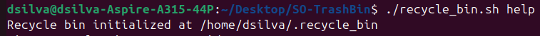

- Recycle bin structure: 
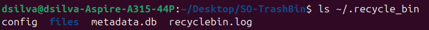

### Test Case 2: Delete Single File
**Objective:** Verify that a single file can be deleted successfully

**Steps:**
1. Create test file: `touch testFile`
2. Run: `./recycle_bin.sh delete testFile`
3. Verify file is removed from current directory
4. Run: `./recycle_bin.sh list`
5. Verify file appears in recycle bin
**Expected Result:**
- File is moved to ~/.recycle_bin/files/
- Metadata entry is created
- Success message is displayed
- File appears in list output
**Actual Result:** 
- Success message is displayed: "File moved as: 1761143792_w5fmrh"
- File is removed from current directory
- Metadata entry is created: "1761143792_w5fmrh|testFile|/home/dsilva/Desktop/SO-TrashBin/testFile|2025-10-22_15-36-32|4|regular file|664|dsilva:dsilva"
- File appears in list output

**Status:** ✅ Pass

**Screenshots:** 
- Success message displayed:
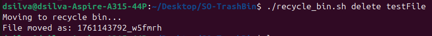

- Metadata entry: 
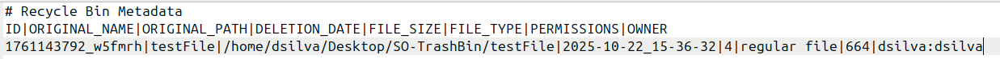

- List output: 
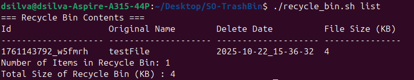

### Test Case 3: Delete Multiple Files in One Command
**Objective:** Verify that multiple files can be deleted successfully

**Steps:**
1. Create multiple test files: `touch testFile1 testFile2 testFile3`
2. Run: `./recycle_bin.sh delete testFile1 testFile2 testFile3`
3. Verify files are removed from current directory
4. Run: `./recycle_bin.sh list`
5. Verify files appear in recycle bin

**Expected Result:**
- Files are moved to ~/.recycle_bin/files/
- Metadata entries are created
- Success messages are displayed
- Files appear in list output

**Actual Result:** 
- Success messages are displayed: "File moved as: 1761144530_sr1jzu", "File moved as: 1761144530_1e1ph2", "File moved as: 1761144531_fkuhhq".
- Files are removed from current directory
- Metadata entries are created: "1761144530_sr1jzu|testFile1|/home/dsilva/Desktop/SO-TrashBin/testFile1|2025-10-22_15-48-50|0|regular empty file|664|dsilva:dsilva", "1761144530_1e1ph2|testFile2|/home/dsilva/Desktop/SO-TrashBin/testFile2|2025-10-22_15-48-50|0|regular empty file|664|dsilva:dsilva", "1761144531_fkuhhq|testFile3|/home/dsilva/Desktop/SO-TrashBin/testFile3|2025-10-22_15-48-51|0|regular empty file|664|dsilva:dsilva"
- Files appear in list output

**Status:** ✅ Pass

**Screenshots:** 
- Success messages displayed:
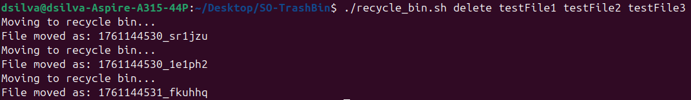

- Metadata entries: 
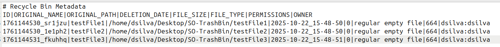

- List output: 
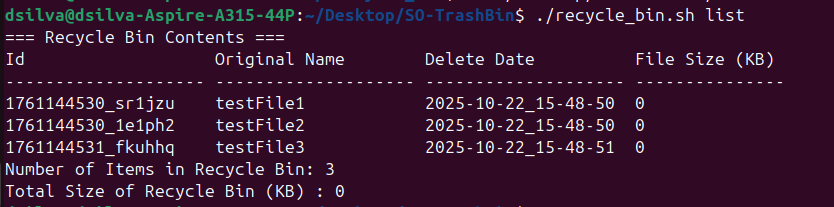

### Test Case 4: Delete Empty Directory
**Objective:** Verify an empty directory can be deleted successfully

**Steps:**
1. Run (Create a new directory): `mkdir -p testDir`
2. Run: `./recycle_bin.sh delete testDir`
3. Verify that the directory is removed 
4. Run: `./recycle_bin.sh list --detailed`
5. Verify that testDir appears on recycle bin

**Expected Result:**
- Directory is moved to ~/.recycle_bin/files/
- Metadata entry is created
- Success message is displayed
- Directory appears in list output

**Actual Result:** 
- Success message is displayed: "File moved as: 1761431980_559qlh"
- Directory is moved
- Metadata entry is created: "1761431980_559qlh|testDir|/home/dsilva/Desktop/SO-TrashBin/testDir|2025-10-25_23-39-40|4|directory|775|dsilva:dsilva"
- Directory appears in list output

**Status:** ✅ Pass

**Screenshots:** 
- Success message displayed:
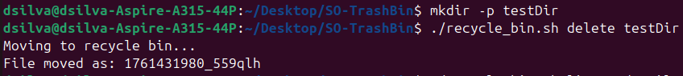

- Metadata entry: 
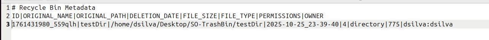

- List output: 
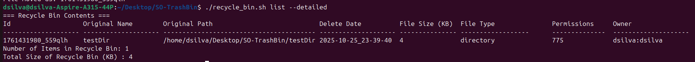

### Test Case 5: Delete Directory with Contents
**Objective:** Verify a directory with contents can be deleted successfully

**Steps:**
1. Run (Create a new directory): `mkdir -p testDir`
2. Run (Create files inside testDir): `touch testDir/testFile1 testDir/testFile2`
2. Run: `./recycle_bin.sh delete testDir`
3. Verify that the directory is removed, aswell as its contents
4. Run: `./recycle_bin.sh list --detailed`
5. Verify that testDir appears on recycle bin
6. Run: `ls ~/.recycle_bin/files/{delete_id}`
7. Verify directory contents are still there

**Expected Result:**
- Directory and its contents are moved to ~/.recycle_bin/files/
- Metadata entry is created
- Success message is displayed
- Directory appears in list output
- Directory contents are still there

**Actual Result:** 
- Success message is displayed: "File moved as: 1761432984_wk4bpj"
- Directory is moved
- Metadata entry is created: "1761432984_wk4bpj|testDir|/home/dsilva/Desktop/SO-TrashBin/testDir|2025-10-25_23-56-24|4|directory|775|dsilva:dsilva"
- Directory appears in list output
- Directory contents are still there: testFile1, testFile2

**Status:** ✅ Pass

**Screenshots:** 
- Success message displayed:
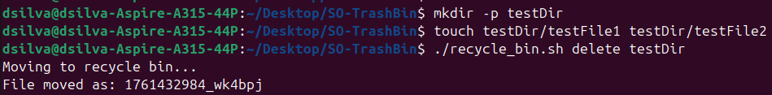

- Metadata entry: 
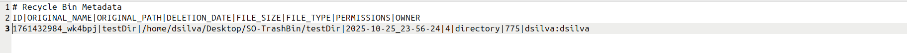

- List output: 
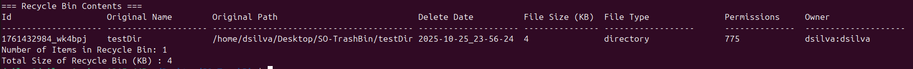

- Directory contents: 
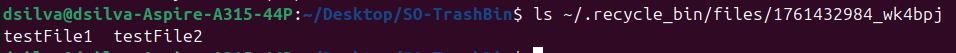

### Test Case 6: List Empty Recycle Bin
**Objective:** Verify that an empty recycle bin is handled by the script

**Steps:**
1. Run `./recycle_bin.sh empty`, ensuring an empty bin
2. Verify that there are no files in recycle bin
3. Run `./recycle_bin.sh list`
4. Verify that empty bin message is displayed

**Expected Result:**
- Recycle bin files folder and metadata are empty
- Empty bin message is displayed

**Actual Result:** 
- Files folder is empty
- Metadata only contains header
- Empty bin message is displayed:

<pre>=== Recycle Bin Contents ===
The Recycle Bin is Currently Empty
</pre>

**Status:** ✅ Pass

**Screenshots:** 
- Output from terminal:

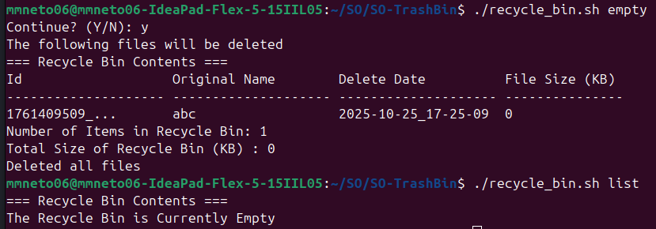

- Empty metadata: 

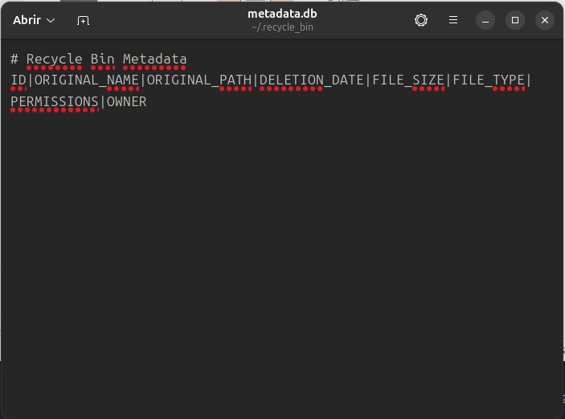

- Empty files folder: 

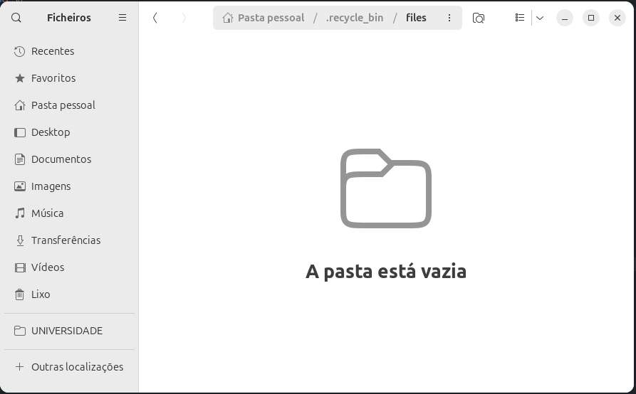

### Test Case 7: Restore Single File
**Objective:** Verify that a single file can be restored successfully

**Pre-condition:** File must already exist in recycle bin (follow Test Case 2: Delete Single File).

**Steps:**
1. Run: `./recycle_bin.sh restore testFile` or `./recycle_bin.sh restore [file_id]`
2. Verify file is back at original directory
3. Run: `./recycle_bin.sh list`
4. Verify restored file does not appear in recycle bin

**Expected Result:**
- File is moved to original directory
- Metadata entry is erased
- Success message is displayed
- File does not appear in list output

**Actual Result:** 
- Success message is displayed: "Restore complete!"
- File is moved to original directory
- Metadata entry is erased
- File does not appear in list output

**Status:** ✅ Pass

**Screenshots:** 
- Success message displayed:

- Metadata file has no entries: 

- List output: 

### Test Case 8: Restore to Non-Existent Original Path
**Objective:** Verify that a file can be restored to a non-existent original path successfully

**Important:** Be careful with file names (it is safer to use file ids) or make sure that recycle bin is empty.

**Steps:**
1. Run (Create test directory): `mkdir -p testDir`
2. Run (Create test file inside test directory): `touch testDir/testFile`
3. Run: `./recycle_bin.sh delete testDir/testFile`
4. Verify that testFile is not inside testDir anymore
5. Run: `rmdir testDir`
6. Verify testDir does not exist anymore
7. Run: `./recycle_bin.sh restore testFile`
8. Run: `ls testDir`
9. Verify that testDir (original directory) is created and that testFile is inside it.

**Expected Result:**
- File is moved to ~/.recycle_bin/files/
- Success deletion message is displayed
- Original directory (deleted) is created
- File is moved to original directory
- Metadata entry is erased
- Success restore message is displayed
- File does not appear in list output

**Actual Result:** 
- Success deletion message is displayed: "File moved as: "
- File is moved to original directory
- Metadata entry is erased
- File does not appear in list output

**Status:** ✅ Pass

**Screenshots:** 
- Success deletion message:
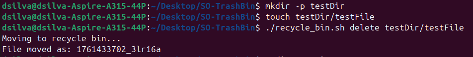

- Success restore message:
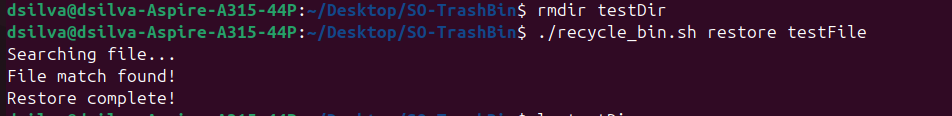

- Metadata file has no entries: 
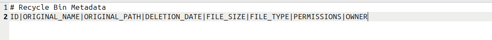

- List output: 
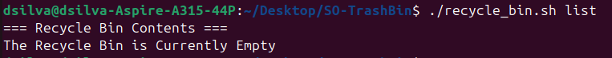

- Original path created: 

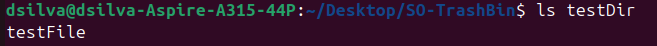

### Test Case 9: Empty Entire Recycle Bin
**Objective:** Verify that the script can empty the whole bin at once

**Steps:**
1. Create some test files with the `touch` command
2. Delete them with `./recycle_bin.sh delete file1 file2 ...`
3. Verify that they were moved with `./recycle_bin.sh list`
4. Empty the whole bin with `./recycle_bon.sh empty`
5. Verify that files folder is now empty
6. Verify thar metadata has also been emptied
7. Run `.recycle_bin.sh list` after to check that it is empty

**Expected Result:**
- Test files are successfully deleted
- Files are successfully listed
- Bin is then successfully emptied
- Metadata and files folder are now reser
- Empty bin is successfully shown

**Actual Result:** 
- Success deletion message is displayed: "File moved as: "
- All files are listed
- Bin is emptied
- Metadata file and files folder have been reset
- No files are shown to be in the bin

**Status:** ✅ Pass

**Screenshots:** 
- Terminal output:

### Test Case 10: Search Existing File
**Objective:** Verify that a search for an existing file can be done successfully

**Pre-condition:** File must already exist in recycle bin (follow Test Case 2: Delete Single File).

**Steps:**
1. Run: `./recycle_bin.sh search testFile`
2. Verify that file information is displayed

**Expected Result:**
- File information is displayed

**Actual Result:** 
- File information is displayed, including file id, original name, original path, deletion date, size, type, permissions and owner.

**Status:** ✅ Pass

**Screenshots:** 
- File informations: 
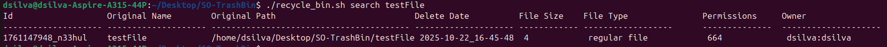

### Test Case 11: Search Non-Existent File
**Objective:** Verify that a search for a non-existent file can not be performed

**Steps:**
1. Run: `./recycle_bin.sh search nonExistentFile`
2. Verify that an error message is displayed

**Expected Result:**
- Error message is displayed

**Actual Result:** 
- Error message is displayed: "Error: No file with 'nonExistentFile' pattern was found."

**Status:** ✅ Pass

**Screenshots:** 
- Error message: 
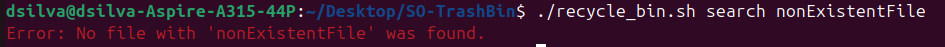

### Test Case 12: Display Help Information
**Objective:** Verify that help information is displayed successfully

**Steps:**
1. Run: `./recycle_bin.sh help` or `./recycle_bin.sh --help` or `./recycle_bin.sh -h`
2. Verify that help message is displayed

**Expected Result:**
- Help message is displayed

**Actual Result:** 
- Help message displays information regarding every executable option of the program

**Status:** ✅ Pass

**Screenshots:** 
- Help message: 
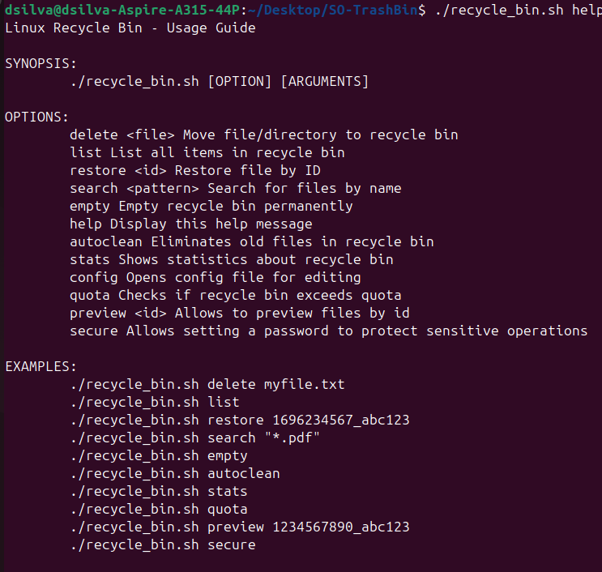

## Edge Cases 

### Test Case 13: Delete Non-Existent File
**Objective:** Verify that it is not possible to delete a non-existent file

**Steps:**
1. Run: `./recycle_bin.sh delete nonExistentFile`
2. Verify that an error message is displayed

**Expected Result:**
- Error message is displayed

**Actual Result:** 
- Error message is displayed: "Error: File 'nonExistentFile' does not exist"

**Status:** ✅ Pass

**Screenshots:** 
- Error message: 
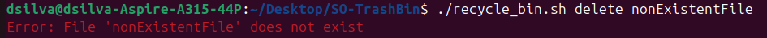

### Test Case 14: Delete File Without Permissions 
**Objective:** Verify that the script handles attempts to delete a file without sufficient permissions correctly.

**Steps:**
1. Run (Create a file on a protected directory): `touch protectedFile`
2. Run (Remove permissions): `chmod 000 protectedFile`
3. Run: `./recycle_bin.sh delete /protectedFile`
4. Verify that an error message is displayed
5. Verify that the file was not moved from it's current directory
6. Run: `./recycle_bin.sh list`
7. Verify that the file does not appear on the list

**Expected Result:**
- Error message is displayed
- File is not moved
- File does not appear on recycle bin files list

**Actual Result:** 
- Error message is displayed: "Error: Permission denied!"
- File is not moved
- File does not appear on recycle bin files list

**Status:** ✅ Pass

**Screenshots:** 
- Test image: 
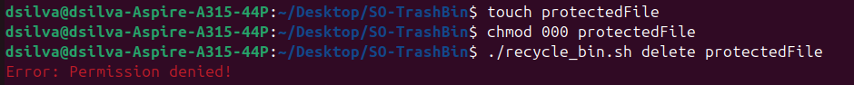

- List output: 

### Test Case 15: Restore when Original Location has same Filename
**Objective:** Verify that the script handles attempts to restore a file, when 

**Pre-condition:** File must already exist in recycle bin (follow Test Case 2: Delete Single File) and there should be a file, with the same name as the deleted one, in the restoring directory.

**Steps:**
1. Run: `./recycle_bin.sh restore duplicateTestFile`
2. Verify that a message informing that there is a file with the same name at original path is displayed
3. Verify that an option list is displayed
4. Select the desired option:

    4.1. Overwrite:
    - Verify that a success message is displayed
    - Run: `./recycle_bin.sh list`
    - Verify that the file does not appear on recycle bin files list

    4.2. Restore with modified name: 
    - Verify that a success message is displayed
    - Run: `./recycle_bin.sh list`
    - Verify that the file does not appear on recycle bin files list
    - Verify that the file in on its original directory, with a modified name

    4.3. Cancel operation: 
    - Verify that a message informing operation cancelation is displayed
    - Run: `./recycle_bin.sh list`
    - Verify that the file still appears on recycle bin files list

**Expected Result:**
- Informing message is displayed
- Option list is displayed
- Overwrite: 
    - Success message is displayed
    - File does not appear on recycle bin files list
- Restore with modified name: 
    - Success message is displayed
    - File does not appear on recycle bin files list
    - File in on its original directory, with a modified name
- Cancel operation: 
    - Informing message is displayed
    - File still appears on recycle bin files list

**Actual Result:** 
- Informing message is displayed: "This file already exists at original path!"
- Option list is displayed: 
    1) Overwrite
    2) Restore with modified name
    3) Cancel operation
- Overwrite:
    - Success message is displayed: "Restore complete!"
    - File does not appear on recycle bin files list
- Restore with modified name: 
    - Success message is displayed: "Restore complete!"
    - File does not appear on recycle bin files list
    - File in on its original directory, with a modified name (originalname_timestamp)
- Cancel operation: 
    - Informing message is displayed: "Cancelling restore."
    - File still appears on recycle bin files list

**Status:** ✅ Pass

**Screenshots:** 
- Overwrite: 

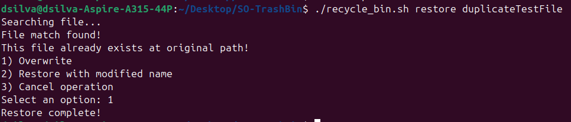
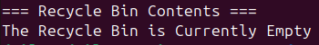

- Restore: 

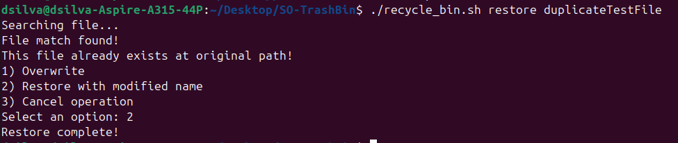

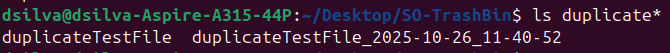

- Cancel operation: 

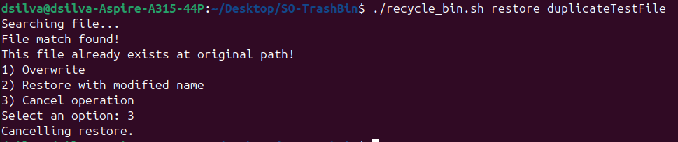
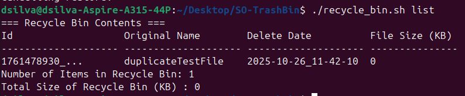

### Test Case 16: Restore with Non-Existent File Id
**Objective:** Verify that the script handles attempts to restore a non-existent id correctly.

**Steps:**
1. Run: `./recycle_bin.sh restore 12345fake_id`
2. Verify that an error message is displayed

**Expected Result:**
- Error message is displayed

**Actual Result:** 
- Error message is displayed: "No match was found for file: 12345fake_id"

**Status:** ✅ Pass

**Screenshots:** 
- Error message: 
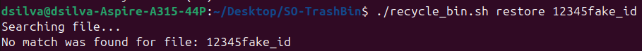

### Test Case 17: Handle Filenames with Spaces 
**Objective:** Verify that the script correctly handles file operations (delete, list, restore) when filenames contain spaces.

**Steps:**
1. Run (Create a new file): `touch "file name with spaces"` 
2. Run: `./recycle_bin.sh delete "file name with spaces"`
3. Verify file is removed from current directory
4. Run: `./recycle_bin.sh list`
5. Verify file appears in recycle bin
6. Run: `./recycle_bin.sh restore "file name with spaces"`
7. Verify file is back at original directory
8. Run: `./recycle_bin.sh list`
9. Verify restored file does not appear in recycle bin

**Expected Result:**
- File is moved to ~/.recycle_bin/files/
- Metadata entry is created
- Success message is displayed
- File appears in list output
- File is moved to original directory
- Metadata entry is erased
- Success message is displayed
- File does not appear in list output

**Actual Result:** 
- Deletion: 
    - Success message is displayed: "File moved as: 1761480507_74bsjb"
    - File is removed from current directory
    - Metadata entry is created: "1761480507_74bsjb|file name with spaces|/home/dsilva/Desktop/SO-TrashBin/file name with spaces|2025-10-26_12-10-24|0|regular empty file|664|dsilva:dsilva"
    - File appears in list output

- Restore: 
    - Success message is displayed: "Restore complete!"
    - File is moved to original directory
    - Metadata entry is erased
    - File does not appear in list output

**Status:** ✅ Pass

**Screenshots:** 
- Deletion: 
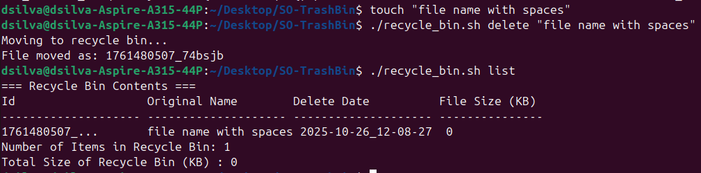
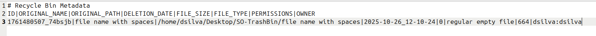

- Restore:
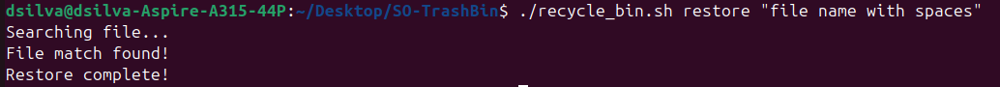
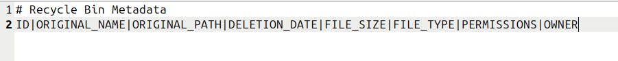 
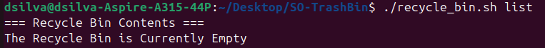

### Test Case 18: Handle Filenames with Special Characters
**Objective:** Verify that the script correctly handles file operations (delete, list, restore) when filenames contain special characters.

**Steps:**
1. Run (Create a new file): `touch 'file@#$%^&*()'` 
2. Run: `./recycle_bin.sh delete 'file@#$%^&*()'`
3. Verify file is removed from current directory
4. Run: `./recycle_bin.sh list`
5. Verify file appears in recycle bin
6. Run: `./recycle_bin.sh restore 'file@#$%^&*()'`
7. Verify file is back at original directory
8. Run: `./recycle_bin.sh list`
9. Verify restored file does not appear in recycle bin

**Expected Result:**
- File is moved to ~/.recycle_bin/files/
- Metadata entry is created
- Success message is displayed
- File appears in list output
- File is moved to original directory
- Metadata entry is erased
- Success message is displayed
- File does not appear in list output

**Actual Result:** 
- Deletion: 
    - Success message is displayed: "File moved as: 1761483443_1z87aw"
    - File is removed from current directory
    - Metadata entry is created: "1761483443_1z87aw|file!@#$%^&*()|/home/dsilva/Desktop/SO-TrashBin/file!@#$%^&*()|2025-10-26_12-57-23|0|regular empty file|664|dsilva:dsilva"
    - File appears in list output

- Restore: 
    - Success message is displayed: "Restore complete!"
    - File is moved to original directory
    - Metadata entry is erased
    - File does not appear in list output

**Status:** ✅ Pass

**Screenshots:** 
- Deletion: 
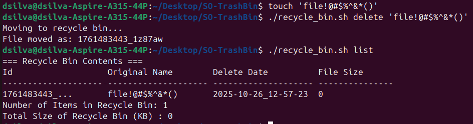
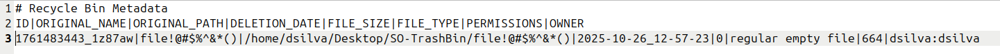

- Restore:
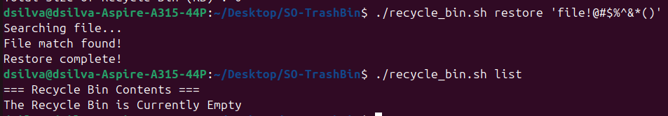
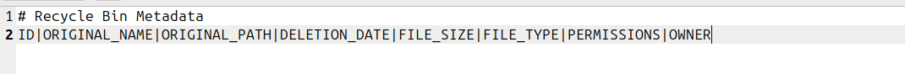 

### Test Case 19: Handle Very Long Filenames
**Objective:** Verify that the script correctly handles files with very long filenames.

**Steps:**
1. Run (Create a new file): `touch "$(printf 'a%.0s' {1..250})"` 
2. Run: `./recycle_bin.sh delete "$(printf 'a%.0s' {1..250})"`
3. Verify file is removed from current directory
4. Run: `./recycle_bin.sh list`
5. Verify file appears in recycle bin
6. Run: `./recycle_bin.sh restore "$(printf 'a%.0s' {1..250})"`
7. Verify file is back at original directory
8. Run: `./recycle_bin.sh list`
9. Verify restored file does not appear in recycle bin

**Expected Result:**
- File is moved to ~/.recycle_bin/files/
- Metadata entry is created
- Success message is displayed
- File appears in list output
- File is moved to original directory
- Metadata entry is erased
- Success message is displayed
- File does not appear in list output

**Actual Result:** 
- Deletion: 
    - Success message is displayed: "File moved as: 1761497096_evxrgs"
    - File is removed from current directory
    - Metadata entry is created: "1761497096_evxrgs|aaaaaaaaaaaaaaaaaaaaaaaaaaaaaaaaaaaaaaaaaaaaaaaaaaaaaaaaaaaaaaaaaaaaaaaaaaaaaaaaaaaaaaaaaaaaaaaaaaaaaaaaaaaaaaaaaaaaaaaaaaaaaaaaaaaaaaaaaaaaaaaaaaaaaaaaaaaaaaaaaaaaaaaaaaaaaaaaaaaaaaaaaaaaaaaaaaaaaaaaaaaaaaaaaaaaaaaaaaaaaaaaaaaaaaaaaaaaaaaaaaaaaaaaaa|/home/dsilva/Desktop/SO-TrashBin/aaaaaaaaaaaaaaaaaaaaaaaaaaaaaaaaaaaaaaaaaaaaaaaaaaaaaaaaaaaaaaaaaaaaaaaaaaaaaaaaaaaaaaaaaaaaaaaaaaaaaaaaaaaaaaaaaaaaaaaaaaaaaaaaaaaaaaaaaaaaaaaaaaaaaaaaaaaaaaaaaaaaaaaaaaaaaaaaaaaaaaaaaaaaaaaaaaaaaaaaaaaaaaaaaaaaaaaaaaaaaaaaaaaaaaaaaaaaaaaaaaaaaaaaaa|2025-10-26_16-44-56|0|regular empty file|664|dsilva:dsilva"
    - File appears in list output

- Restore: 
    - Success message is displayed: "Restore complete!"
    - File is moved to original directory
    - Metadata entry is erased
    - File does not appear in list output

**Status:** ✅ Pass

**Screenshots:** 
- Deletion: 
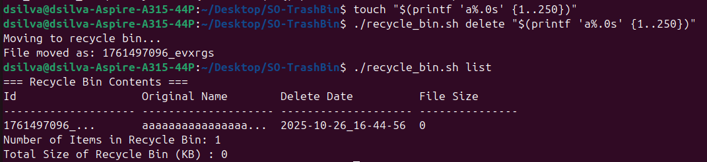
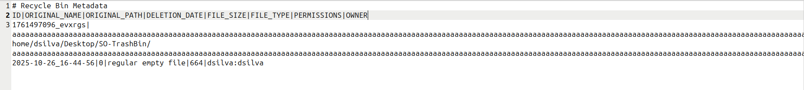

- Restore:
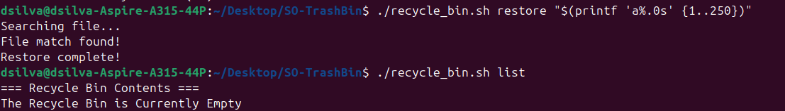
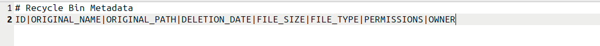 

### Test Case 20: Handle Very Large Files 
**Objective:** Verify that the script correctly handles the deletion and restoration of very large files without errors or data corruption.

**Steps:**
1. Run (Create a large file): `fallocate -l 150M largeTestFile`; [Reference](https://stackoverflow.com/questions/257844/quickly-create-a-large-file-on-a-linux-system)
2. Run: `./recycle_bin.sh delete largeTestFile`
3. Verify file is removed from current directory
4. Run: `./recycle_bin.sh list`
5. Verify file appears in recycle bin
6. Run: `./recycle_bin.sh restore largeTestFile`
7. Verify file is back at original directory
8. Run: `./recycle_bin.sh list`
9. Verify restored file does not appear in recycle bin

**Expected Result:**
- File is moved to ~/.recycle_bin/files/
- Metadata entry is created
- Success message is displayed
- File appears in list output
- File is moved to original directory
- Metadata entry is erased
- Success message is displayed
- File does not appear in list output

**Actual Result:** 
- Deletion: 
    - Success message is displayed: "File moved as: 1761485312_8exqzv"
    - File is removed from current directory
    - Metadata entry is created: "1761485312_8exqzv|largeTestFile|/home/dsilva/Desktop/SO-TrashBin/largeTestFile|2025-10-26_13-28-32|153600|regular file|664|dsilva:dsilva"
    - File appears in list output

- Restore: 
    - Success message is displayed: "Restore complete!"
    - File is moved to original directory
    - Metadata entry is erased
    - File does not appear in list output

**Status:** ✅ Pass

**Screenshots:** 
- Deletion: 
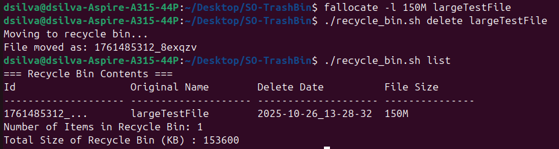
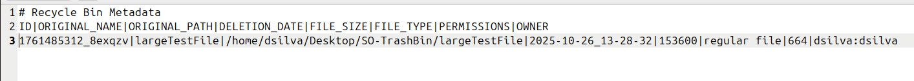

- Restore:

 

### Test Case 21: Handle Symbolical Links
**Objective:** Verify that the script correctly handles the deletion and restoration of symbolic links.

**Steps:**
1. Run (Create a test file): `touch testFile`
2. Run (Create a test symbolic link): `ln -s testFile linkToTestFile`; [Reference](https://www.freecodecamp.org/news/linux-ln-how-to-create-a-symbolic-link-in-linux-example-bash-command/)
3. Run: `./recycle_bin.sh delete linkToTestFile`
4. Verify that link is moved but testFile is still on current directory
5. Run: `./recycle_bin.sh list`
5. Verify link appears in recycle bin
6. Run: `./recycle_bin.sh restore linkToTestFile`
7. Verify link is back at original directory
8. Run: `./recycle_bin.sh list`
9. Verify restored link does not appear in recycle bin

**Expected Result:**
- Link is moved to ~/.recycle_bin/files/
- Metadata entry is created
- Success message is displayed
- Link appears in list output
- Link is moved to original directory
- Metadata entry is erased
- Success message is displayed
- Link does not appear in list output

**Actual Result:** 
- Deletion: 
    - Success message is displayed: "File moved as: 1761559436_zp1jar"
    - Link is removed from current directory
    - Metadata entry is created: "1761559436_zp1jar|linkToTestFile|/home/dsilva/Desktop/SO-TrashBin/linkToTestFile|2025-10-27_10-03-56|0|symbolic link|777|dsilva:dsilva"
    - Link appears in list output

- Restore: 
    - Success message is displayed: "Restore complete!"
    - Link is moved to original directory
    - Metadata entry is erased
    - Link does not appear in list output

**Status:** ✅ Pass

**Screenshots:** 
- Deletion: 

- Restore:

 

### Test Case 22: Handle Hidden Files 
**Objective:** Verify that the script correctly handles the deletion and restoration of hidden files.

**Steps:**
1. Run (Create a hidden file): `touch .hiddenFile` 
2. Run: `./recycle_bin.sh delete .hiddenFile`
3. Verify file is removed from current directory
4. Run: `./recycle_bin.sh list`
5. Verify file appears in recycle bin
6. Run: `./recycle_bin.sh restore .hiddenFile`
7. Verify file is back at original directory
8. Run: `./recycle_bin.sh list`
9. Verify restored file does not appear in recycle bin

**Expected Result:**
- File is moved to ~/.recycle_bin/files/
- Metadata entry is created
- Success message is displayed
- File appears in list output
- File is moved to original directory
- Metadata entry is erased
- Success message is displayed
- File does not appear in list output

**Actual Result:** 
- Deletion: 
    - Success message is displayed: "File moved as: 1761494928_6ca2u8"
    - File is removed from current directory
    - Metadata entry is created: "1761494928_6ca2u8|.hiddenFile|/home/dsilva/Desktop/SO-TrashBin/.hiddenFile|2025-10-26_16-08-48|0|regular empty file|664|dsilva:dsilva"
    - File appears in list output

- Restore: 
    - Success message is displayed: "Restore complete!"
    - File is moved to original directory
    - Metadata entry is erased
    - File does not appear in list output

**Status:** ✅ Pass

**Screenshots:** 
- Deletion: 

- Restore:

 

### Test Case 23: Delete Files from Different Directories
**Objective:** Verify files from different directories can be deleted successfully

**Steps:**
1. Run (Create test directories): `mkdir -p ~/testDir1` and `mkdir -p ~/testDir2`
2. Run (Create test files): `touch ~/testDir1/testFile1 ~/testDir2/testFile2`
3. Run: `./recycle_bin.sh delete ~/testDir1/testFile1 ~/testDir2/testFile2`
4. Verify files are removed from their current directory
5. Run: `./recycle_bin.sh list`
6. Verify files appear in recycle bin
7. Run: `./recycle_bin.sh restore testFile1`
8. Run: `./recycle_bin.sh restore testFile2`
9. Run: `ls ~/testDir1 ~/testDir2`
10. Verify each file is back at original directory
11. Run: `./recycle_bin.sh list`
12. Verify restored files do not appear in recycle bin

**Expected Result:**
- File is moved to ~/.recycle_bin/files/
- Metadata entry is created
- Success message is displayed
- File appears in list output
- File is moved to original directory
- Metadata entry is erased
- Success message is displayed
- File does not appear in list output

**Actual Result:** 
- Deletion: 
    - Success message is displayed: "File moved as: 1761495988_9ilhma" and "File moved as: 1761495988_truz4p"
    - Files are removed from their current directory
    - Metadata entry is created: "1761495988_9ilhma|testFile1|/home/dsilva/testDir1/testFile1|2025-10-26_16-26-28|0|regular empty file|664|dsilva:dsilva" and "1761495988_truz4p|testFile2|/home/dsilva/testDir2/testFile2|2025-10-26_16-26-28|0|regular empty file|664|dsilva:dsilva"
    - File appears in list output

- Restore: 
    - Success messages are displayed: "Restore complete!"
    - Files are moved to their original directory
    - Metadata entries are erased
    - Files do not appear in list output

**Status:** ✅ Pass

**Screenshots:** 
- Deletion: 

- Restore:

 

- Files back at original path: 

### Test Case 24: Restore Files to Read-Only Directories 
**Objective:** Verify that a file can not be restores to read-only directories

**Steps:**
1. Run (Create a test directory): `mkdir -p testDir`
2. Run (Create a test file inside testDir): `touch testDir/testFile`
3. Run: `./recycle_bin.sh delete testDir/testFile`
4. Verify file is removed from current directory
5. Run: `./recycle_bin.sh list`
6. Verify file appears in recycle bin
7. Run (Remove writing and execute permissions): `chmod -wx testDir` 
8. Run: `./recycle_bin.sh restore testFile`
9. Verify that an error message is displayed
10. Run: `./recycle_bin.sh list`
11. Verify file is still in recycle bin

**Expected Result:**
- Success deletion message is displayed
- File is removed from current directory
- Metadata entry is created
- File appears in list output
- Error message is displayed
- File is not restored

**Actual Result:** 
- Success deletion message is displayed: "File moved as: 1761498050_5hfzm6"
- File is removed from current directory
- Metadata entry is created
- File appears in list output
- Error message is displayed: "Error: Permission denied!"
- File is not restored

**Status:** ✅ Pass

**Screenshots:** 
- Test image:

## Error Handling 

### Test Case 25: Invalid Command Line Arguments
**Objective:** Verify that the script handles attempts to execute non existent commands

**Steps:**
1. Run a non existent command: `./recycle_bin.sh nonexistentcommand abc 123`
2. Verify that an error message is displayed

**Expected Result:**
- Error message is displayed
- Nothing within the directory ~/recycle_bin is changed

**Actual Result:** 
- Error message is displayed: "Invalid option. Use 'help' for usage information."
- Nothing in that directpry changes since no other function was called

**Status:** ✅ Pass

**Screenshots:** 
- Error message: 

### Test Case 26: Missing Required Parameters
**Objective:** Check that the script alerts the user of missing and/or required paramaters

**Steps:**
1. Run a command that requires a paramater, like delete: `./recycle_bin.sh delete`
2. Verify that an error message is displayed

**Expected Result:**
- Error message is displayed
- User is informed of correct usage

**Actual Result:** 
- Error message is displayed: "Must indicate at least one file/directory for deletion"
- User is informed of correct use: "Use: ./recycle_bin.sh delete \<file1\> \<file2\> ... \<fileN\>"

**Status:** ✅ Pass

**Screenshots:** 
- Error message: 

### Test Case 27: Corrupted Metadata File
**Objective:** Verify that the script correctly handles corrupted metadata file

**Steps:**
1. Run (Remove metadata file): `rm ~/.recycle_bin/metadata.db`
2. Run any script function: `./recycle_bin.sh help` (for example)
3. Verify that an error message is displayed and metadata file is repaired

**Expected Result:**
- Error message is displayed
- Metadata file is repaired

**Actual Result:** 
- Error message is displayed: "Error: Metadata file is missing or unreadable"
- Metadata file is repaired

**Status:** ✅ Pass

**Screenshots:** 
- Error message: 

### Test Case 28: Insufficient Disk Space
**Objective:** Check that the script neither deletes a file larger than the maximum allowed, nor restores a file larger than the available disk space.

**Pre-condition:** The MAX_SIZE_MB variable must be configured

**Steps:**
1. Make a large empty file: `fallocate -l 50G largefile.bin` (50GB is enough for my disk)
2. Attempt to delete the file with the script: `./recycle_bin.sh delete largefile.bin`
3. Verify that an error message is displayed for deletion
4. Increase the maximum allowed size for the recycle bin, with `./recycle_bin.sh config`
5. Delete the file with the script: `./recycle_bin.sh delete largefile.bin`
6. Make sure the file was moved: `./recycle_bin.sh list`
7. Attempt to restore the large file `./recycle_bin.sh restore largefile.bin`
8. Verify that an error message is siplayed for restoration 

**Expected Result:**
- First error message is shown for a file that is too big
- After reconfiguration, the file is succesfully deleted
- Attempting to restore the file shows the second error message

**Actual Result:** 
- 1st error message is diplayed: "Error: Not enough space available!"
- Large file is moved to the recycle bin
- 2nd error message is displayed: "Error: Not enough space available!"

**Status:** ✅ Pass

**Screenshots:** 
- Terminal output for both deletion and restoration attempts: 

### Test Case 29: Permission Denied Errors
**Objective:** Check that the script does not remove files or directories without system permission

**Steps:**
1. Run (make a test directory): `mkdir .test`
2. Run (create a test file): `touch ./.test/test`
3. Run (remove all permissions from the test directory): `chmod 0 ./.test`
4. Run (try to delete the file with the script): `./recycle_bin.sh delete ./.test/test`
5. Run (try to delete the directory with the script): `./recycle_bin.sh delete ./.test`
6. Verify that an error message is displayed either by the system or by the script

**Expected Result:**
- Error message is displayed by either the system or the script itself
- File is not moved to the recycle bin
- Directory is not moved to the recycle bin

**Actual Result:** 
- Error message is displayed by the script for the file: "Error: File './.test/test' does not exist"
- Error message is displayed by the system (and a bit of the script) for the directory: 
<pre>du: impossível ler a pasta &apos;/home/mmneto06/SO/SO-TrashBin/.test&apos;: Permissão recusada
Moving to recycle bin...
mv: impossível mover &apos;/home/mmneto06/SO/SO-TrashBin/.test&apos; para &apos;/home/mmneto06/.recycle_bin/files/1761404641_fwybob&apos;: Permissão recusada
Error: Permission denied!
</pre>
- Recycle bin, test file and test directory remain in their original conditions

**Status:** ✅ Pass

**Screenshots:** 
- Error messages: 

### Test Case 30: Attempting to Delete Recycle Bin Itself
**Objective:** Check that the script stops user from deleting the recycle bin itself

**Steps:**
1. Run the command: `./recycle_bin.sh delete ~/.recycle_bin`
2. Verify that an error message is displayed

**Expected Result:**
- Error message is displayed
- Recycle bin is not deleted and stays the same

**Actual Result:** 
- Error message is displayed: "Error: Cannot delete recycle bin itself."
- ~/.recycle_bin still exists and is unchanged
- Log file logs attempt at deleting recycle_bin

**Status:** ✅ Pass

**Screenshots:** 
- Error message: 

### Test Case 31: Concurrent Operations
**Objective:** Verify that concurrent operations are not allowed

**Steps:**
1. Run (Create test files): `touch testFile1 testFile2`
2. Run: `./recycle_bin.sh delete testFile1 & ./recycle_bin.sh delete testFile2 & wait`
3. Verify that an error message is displayed
4. Run: `./recycle_bin.sh list`
5. Verify that only one file is moved

**Expected Result:**
- Error message is displayed
- Only one file is moved

**Actual Result:** 
- Error message is displayed: "Error: Another instance running!"
- Only one file is moved 

**Status:** ✅ Pass

**Screenshots:** 
- File informations: 

## Performance Tests

### Test Case 32: Delete 100+ Files
**Objective:** Check how fast the script can delete 100 files

**Steps:**
1. Create 100 files, all with the touch command
2. Delete each one individually
3. Check how long it took to delete them all

OR

1. Run the auxiliary script testingMdScripts/performance.sh to do the above steps automatically

**Expected Result:**
- All files created are deleted
- Script doesn't take a long time to run

**Actual Result:** 
- Script ran successfully to delete 100 files
- Time elapsed to delete is always slighly different, but averages at 2 seconds
- That means that, on average, it takes 0.02 seconds to delete a file

**Status:** ✅ Pass

**Screenshots:** 
- Testing image: 

...

- After this, the recycle_bin.sh script is run to empty the recycle bin, and the temporary test directory that held the test files is deleted 

### Test Case 33: List Recycle Bin with 100+ Files
**Objective:** Check how fast the script can list 100 files

**Steps:**
1. Create 100 files, all with the touch command
2. Delete each one individually
3. Run script with list command
4. Check how long it took to list them all

OR

1. Run the auxiliary script testingMdScripts/performance.sh to do the above steps automatically

**Expected Result:**
- All files created are listed
- Script doesn't take a long time to run

**Actual Result:** 
- Script runs successfully
- Time elapsed is always different, but averages at 0.008 seconds
- That means that, on average, it takes the list command 0.00008 seconsd per file to fully run
- NOTE: the '--detailed' flag does not change the average time to list

**Status:** ✅ Pass

**Screenshots:** 
- Testing image: 

- After this, the recycle_bin.sh script is run to empty the recycle bin, and the temporary test directory that held the test files is deleted 

### Test Case 34: Search in Large Metadata File
**Objective:** Check how fast the script can restore a file from the bin with 100 items

**Steps:**
1. Create 100 files, all with the touch command
2. Delete each one individually
3. Run script with the command search 1, for example
4. Check how long it took to restore the file

OR

1. Run the auxiliary script testingMdScripts/performance.sh to do the above steps automatically

**Expected Result:**
- The script successfully finds all items with a 1 in it's original name/path
- Script doesn't take a long time to run

**Actual Result:** 
- Script runs successfully
- Time elapsed is always different, depeneds how many items show up. In this case, it took on average 0.3 seconds
- If we use as the search pattern something that every files has, it takes roughly 2 seconds, the same ammount of time it took to delete all the files

**Status:** ✅ Pass

**Screenshots:** 
- Testing image: 

- After this, the recycle_bin.sh script is run to empty the recycle bin, and the temporary test directory that held the test files is deleted 

### Test Case 35: Restore from Recycle Bin with Many Items
**Objective:** Check how fast the script can restore a file from the bin with 100 items

**Steps:**
1. Create 100 files, all with the touch command
2. Delete each one individually
3. Run script with the command restore file_100, to test worst case scenario
4. Check how long it took to restore the file

OR

1. Run the auxiliary script testingMdScripts/performance.sh to do the above steps automatically

**Expected Result:**
- The file is successfully restored
- Script doesn't take a long time to run

**Actual Result:** 
- Script runs successfully
- Time elapsed is always different, but averages at 0.2 seconds

**Status:** ✅ Pass

**Screenshots:** 
- Testing image: 

- After this, the recycle_bin.sh script is run to empty the recycle bin, and the temporary test directory that held the test files is deleted 

## Optional Features Tests

### Test Case 36: Automatically clean the Recycle Bin
**Objective:** Verify that the recycle bin will automatically clean old files when prompted to

**Pre-condition:** The configuration file must have a value different than -1 for the RETENTION_DAYS variable. For the purposes of this test, given how it is set, setting it to 0 should work.

**Steps:**
0. Alter the configuration file, easily accessible with `./recycle_bin.sh config` 
1. Create and delete a file: `touch test.txt; ./recycle_bin delete test.txt`
2. Ensure that the file was deleted: `./recycle_bin.sh list`
3. Run auto-cleanup: `./recycle_bin.sh autoclean`
4. Check that the bin has been emptied of the old files

**Expected Result:**
- File is moved to the recycle bin
- Then autoclean detects that it is older than 0 days
- The file is automatically removed

**Actual Result:** 
- File is moved to recycle_bin
- Terminal displays that autoclean has run successfully:
<pre>auto_cleanup will delete 1761491139_48r21n - test.txt
1761491139_48r21n - test.txt permanently deleted
1761491139_48r21n - test.txt removed from metadata
Autoclean deleted 1 files
</pre>

**Status:** ✅ Pass

**Screenshots:** 
- Terminal output:

### Test Case 37: Show statistics about the Recycle Bin
**Objective:** Check that the recycle bin will display statistics about itself when prompted to

**Steps:**
1. Create and delete multiple files: `touch test.txt; ./recycle_bin delete test.txt; ...`
2. Ensure that the files were deleted: `./recycle_bin.sh list`
3. Run the command: `./recycle_bin.sh stats`
4. Check that the statistics are correctly displayed

**Expected Result:**
- Files are moved to the recycle bin
- Statistics are correctly displayed

**Actual Result:** 
- File are moved
- Terminal displays that statistics were shown successfully:

**Status:** ✅ Pass

**Screenshots:** 
- Terminal output:

### Test Case 38: Set password for Recycle Bin
**Objective:** Check that a recycle_bin password can be set and used

**Pre-condition:** There is at least one item in the recycle bin and there isn't a password already set

**Steps:**
1. Run `./recycle_bin.sh secure`
2. Set a password through the displayed interface
3. Run a sensitive command, like `./recycle_bin.sh empty`
4. Check that the script asks for the password, and that the `empty` command runs after inserting the password 

**Expected Result:**
- Password is successfully set
- The `empty` command asks for password before continuing
- The bin is then promptly emptied

**Actual Result:** 
- Password was set, as shown by terminal
- Empty command runs succesfully, with required password

**Status:** ✅ Pass

**Screenshots:** 
- Terminal output:

### Test Case 39: Change password for Recycle Bin
**Objective:** Check that a recycle_bin password can be changed

**Pre-condition:** There is at least one item in the recycle bin and there is a password already set

**Steps:**
1. Run `./recycle_bin.sh secure`
2. Change the password by picking option 2 and following the instructions
3. Run a sensitive command, like `./recycle_bin.sh empty`
4. Check that the script asks for the password, and that the `empty` command runs after inserting the new password 

**Expected Result:**
- Password is successfully changed
- The `empty` command asks for password before continuing
- The bin is then promptly emptied

**Actual Result:** 
- Password was changed, as shown by terminal
- Empty command runs succesfully, with the new password

**Status:** ✅ Pass

**Screenshots:** 
- Terminal output:

### Test Case 40: Disable password for Recycle Bin

**Objective:** Check that a recycle_bin password can be disabled

**Pre-condition:** There is at least one item in the recycle bin and there is a password already set

**Steps:**
1. Run `./recycle_bin.sh secure`
2. Disable the password by picking option 1 and following the instructions
3. Run a sensitive command, like `./recycle_bin.sh empty`
4. Check that the script asks for the password, and that the `empty` command runs after inserting the new password 

**Expected Result:**
- Password is successfully disabled
- The `empty` command doesn't ask for password before continuing, only confirmation
- The bin is then promptly emptied

**Actual Result:** 
- Password was disabled, as shown by terminal
- Empty command runs succesfully, with the new password

**Status:** ✅ Pass

**Screenshots:** 
- Terminal output:

### Test Case 41: Wrong password aborts operation
**Objective:** Check that the script will abort an operation if the wrong password is given

**Pre-condition:** There is at least one item in the recycle bin and there is a password already set

**Steps:**
1. Run a sensitive command, like `./recycle_bin.sh empty`
2. Check that the script asks for the password
3. Insert a wrong password
4. Check that an error message is displayed

**Expected Result:**
- The `empty` command asks for password before continuing
- Error message is displayed

**Actual Result:** 
- Password was asked for
- Error message is displayed: ""

**Status:** ✅ Pass

**Screenshots:** 
- Terminal output:

### Test Case 42: Preview first 10 lines of file
**Objective:** Verify that a file can be previewed (first 10 lines)

**Steps:**
1. Run (Create a file): `touch testFile`
2. Run (Edit file and write at least 10 lines): `nano testFile`
3. Run: `./recycle_bin.sh delete testFile`
4. Run: `./recycle_bin.sh preview [file_id]`  
5. Verify that the first 10 lines of the file are displayed

**Expected Result:**
- First ten lines of the file are displayed

**Actual Result:** 
- First ten lines of the file are displayed: (See screenshot)

**Status:** ✅ Pass

**Screenshots:** 
- Terminal output:

### Test Case 43: View information of a binary file
**Objective:** Verify that information of a binary file can be consulted

**Steps:**
1. Take a random screenshot 
2. Save it with a desired name, for example, testImage.png
3. Run: `./recycle_bin.sh delete testImage.png`
4. Run: `./recycle_bin.sh preview [file_id]`  
5. Verify that file informations are displayed

**Expected Result:**
- File informations are displayed

**Actual Result:** 
- File informations are displayed: (See screenshot)

**Status:** ✅ Pass

**Screenshots:** 
- Terminal output:

### Test Case 44: Check recycle bin size is within limits
**Objective:** Verify that recycle bin size is within limits

**Steps:**
1. Run: `./recycle_bin.sh quota`
2. If:
    - Recycle bin is full: 
        - Verify that an error message is displayed
        - Verify that an option to clear some space is displayed 
    - Recycle bin is not full:
        - Verify that an information message is displayed
3. Run: `./recycle_bin.sh list`
4. Verify that the output matches information displayed on the messages

**Expected Result:**
- Recycle bin is full: 
    - Error message is displayed
    - An option to clear space is displayed
    - If user agrees, files are eliminated

- Recycle bin is not full: 
    - Infomation message is displayed

**Actual Result:** 
- Recycle bin is full: 
    - Error message is displayed: "WARNING: Recycle bin is full!"
    - An option to clear space is displayed: "Do you want to clear some space in recycle bin? [Y/N]"    
    - User agreed, files were eliminated

- Recycle bin is not full: 
    - Infomation message is displayed: "Recycle bin size is valid!"

**Status:** ✅ Pass

**Screenshots:** 
- Full Recycle Bin:

- Not Full Recycle Bin:

